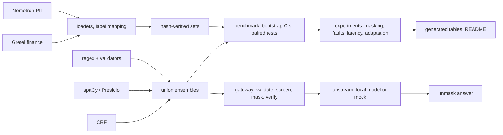

<!-- Generated by `python scripts/make_results.py --readme` from results/. Do not edit by hand. -->
# llm-privacy-gateway

A fail-closed privacy gateway for LLM requests, with a reproducible benchmark of how much personal
data (PII) regex, spaCy, Presidio and trained CRF detectors leave behind.

[](https://github.com/echchakarhaitam-cyber/llm-privacy-gateway/actions/workflows/ci.yml) [](LICENSE)

## Executive summary

- **Off-the-shelf detection leaves much PII uncovered.** The best off-the-shelf configuration (`regex+presidio`) leaves 0.369 / 0.351 / 0.509 of the gold PII characters uncovered (dev / Nemotron test / Gretel).
- **A CRF trained on 5,000 synthetic documents** reaches 0.065 / 0.076 / 0.412; its union with regex and Presidio 0.050 / 0.060 / 0.318. The gain shrinks sharply out of distribution (Gretel).
- **Domain adaptation (RQ11):** 500 Gretel training documents move the CRF's Gretel leakage from 0.412 to 0.282; on Gretel, `crf_n5k_g500+regex+presidio` leaks less than `crf+regex+presidio` (0.192 vs 0.318). The dev leakage of the adapted CRF changes by +0.005.
- **The detector, not the masking strategy, sets privacy:** with `crf+regex+presidio` on dev, redact and typed masking leak 0.050 and 0.050, partial masking 0.131; typed masking changes domain-classification accuracy by -0.018.
- **Gateway under injected faults (RQ9).** Fail-closed: 0 unscreened requests forwarded and 0 fault-induced leaks over 1783 injected faults. Fail-open: the worst condition (exception, q = 0.2) leaked 207 of 1000 requests. Fail-closed availability at q = 0.2 with a detector fault was at least 0.792.
- **Latency (RQ10)**, measured under recorded background load (not an idle machine): median in-process p50 `none` 2.1 ms, `regex` 2.6 ms, `crf` 9.9 ms, `crf+regex+presidio` 105.5 ms.

Numbers are generated from committed results; all data are synthetic. Details: [docs/results.md](docs/results.md), [docs/README.md](docs/README.md).

## Problem statement

A text $x$ carries gold spans $G(x)=\{(s_i,e_i,t_i)\}$: half-open character intervals with an
entity type. A detector returns spans $D(x)$; a masking function $M$ maps $(x, D(x))$ to a masked
text $\tilde x$ and a mapping $\pi$ (placeholder to original) that restores the model's answer.

- **Character leakage** $L=\lvert C_G\setminus C_D\rvert / \lvert C_G\rvert$, where $C_G$ and
  $C_D$ are the characters covered by gold and by detected spans, pooled over a corpus, with 95 %
  document-bootstrap intervals. For redact, typed and pseudonym masking the leaked characters are
  exactly the undetected ones; partial masking also keeps some characters by design.
- **Utility**: the share of non-PII characters preserved, the length ratio, and the accuracy
  change of a domain classifier on masked versus original text.
- **Fail-closed invariant**: for every request $r$ and every failure in the screening path
  (detector exception, timeout, malformed output, mapping error), the upstream receives nothing;
  it only ever receives $M(r, D(r))$, after the masked text was verified to unmask back to $r$.

## Motivation

Text sent to an externally hosted language model leaves its owner's control. A gateway can remove
personal data first, but only if its detectors are measured rather than assumed and a screening
failure can never degrade into sending raw text. The project was motivated by hands-on internship
work on privacy-preserving LLM platforms; it is an independent research project built only from
public datasets, open-source libraries and textbook methods.

## Architecture



| module | role |
|---|---|
| `privgate.spans`, `privgate.evaluation` | span model; strict, partial and type-agnostic matching; character leakage |
| `privgate.data` | pinned loaders, label mapping, normalisation, deterministic splits |
| `privgate.detectors` | regex with checksum validators, spaCy, Presidio, union ensemble |
| `privgate.ml` | tokenisation, BIO tags, CRF and per-token logistic regression, training-pool guard |
| `privgate.masking` | redact, typed, pseudonym and partial masking; collision-safe reversible mapping |
| `privgate.bench` | benchmark runner, bootstrap, privacy and utility metrics, error taxonomy |
| `privgate.gateway` | FastAPI gateway: request whitelist, policy, fail-closed screening, audit log, upstreams |
| `scripts/` | downloads, training, experiments and every table generator |

## Methods

- **Regex baseline** with validators (Luhn for card numbers, ISO 13616 mod-97 for IBANs),
  **spaCy** `en_core_web_lg` NER and **Presidio** (score threshold chosen on dev only). **Union
  ensembles** resolve overlaps deterministically (longer span first, then higher score).
- **Linear-chain CRF** (CRFsuite, L-BFGS, L1 + L2 regularisation) on hand-crafted token features,
  trained on the Nemotron train split with dev-only model selection
  ([docs/theory/02-crf.md](docs/theory/02-crf.md)).
- **Masking**: redact, typed placeholders, Faker pseudonyms and partial masking; placeholders are
  tagged when the input already contains placeholder-like text, and every mapping is verified to
  round-trip ([docs/theory/03-masking.md](docs/theory/03-masking.md)).
- **Gateway**: strict request whitelist, per-type mask or block policy, detection in a worker
  thread under a time budget, one mapping per request, a single upstream call site, and an audit
  log that records counts and error classes only ([docs/GATEWAY.md](docs/GATEWAY.md)).

## Data and attribution

- **Nemotron-PII** by NVIDIA Corporation, <https://huggingface.co/datasets/nvidia/Nemotron-PII>,
  licensed under [CC BY 4.0](https://creativecommons.org/licenses/by/4.0/). Changes made: labels
  mapped onto 12 types, adjacent same-label spans merged, spans verified and trimmed, documents
  split into train, dev and test sets.
- **Gretel synthetic PII finance (multilingual)**, English files, by Gretel.ai,
  <https://huggingface.co/datasets/gretelai/synthetic_pii_finance_multilingual>, licensed under
  [Apache-2.0](https://www.apache.org/licenses/LICENSE-2.0).
- Both datasets are synthetic. **No dataset file and no trained model is redistributed**: the
  pinned files are downloaded and hash-checked locally ([docs/DATA.md](docs/DATA.md)).

## Installation

Python 3.10 to 3.12. Extras: `dev` (pytest, ruff), `data` (pyarrow), `detectors` (spaCy,
Presidio), `ml` (CRFsuite, scikit-learn), `masking` (Faker), `gateway` (FastAPI, uvicorn, httpx,
psutil), `plots` (matplotlib).

```powershell
# Windows PowerShell
python -m venv .venv; .venv\Scripts\Activate.ps1
pip install -e ".[dev,data,detectors,ml,masking,gateway,plots]"
python scripts/install_model.py   # optional: spaCy en_core_web_lg, hash-checked
```

```bash
# macOS / Linux
python3 -m venv .venv && source .venv/bin/activate
pip install -e ".[dev,data,detectors,ml,masking,gateway,plots]"
python scripts/install_model.py   # optional: spaCy en_core_web_lg, hash-checked
```

## Quick start

**(a) Detect and mask in Python** (the regex detector needs no model):

```python
from privgate.detectors.regex import RegexDetector
from privgate.masking import mask, unmask

text = "Contact Anna Lee at anna.lee@example.org or +33 6 12 34 56 78. Card: 4111 1111 1111 1111."
spans = RegexDetector().detect(text)
print([(s.label.value, text[s.start:s.end]) for s in spans])

masked = mask(text, spans, "typed")                 # reversible placeholders
print(masked.text)
print(dict(masked.mapping))
print(unmask("Please write to <EMAIL_1>.", masked.mapping))
```

Output, captured by actually running it (`scripts/capture_readme_facts.py`):

```text
[('EMAIL', 'anna.lee@example.org'), ('PHONE', '+33 6 12 34 56 78'), ('CREDIT_CARD', '4111 1111 1111 1111')]
Contact Anna Lee at <EMAIL_1> or <PHONE_1>. Card: <CREDIT_CARD_1>.
{'<EMAIL_1>': 'anna.lee@example.org', '<PHONE_1>': '+33 6 12 34 56 78', '<CREDIT_CARD_1>': '4111 1111 1111 1111'}
Please write to anna.lee@example.org.
```

The regex baseline finds the structured identifiers and misses the name: the gap the CRF and
Presidio address (RQ1-RQ6).

**(b) Run the gateway with the mock upstream and send one request** (bash; in PowerShell call
`curl.exe` and put the JSON body in a file, `-d "@request.json"`):

```bash
python -m privgate.gateway --mock-upstream --detector regex --port 8088   # terminal 1
curl -s -i http://127.0.0.1:8088/v1/chat/completions -H 'Content-Type: application/json' -d '{"model": "demo", "messages": [{"role": "user", "content": "Email anna.lee@example.org and call +33 6 12 34 56 78."}]}'   # terminal 2
```

Real response (status line, request-id header, body). The mock upstream echoes the *masked*
prompt it received (`<EMAIL_1>`, `<PHONE_1>`); the gateway restored the originals:

```text
HTTP/1.1 200 OK
x-privgate-request-id: e04a031b8e334a868fbd99dc799f585b

{"choices": [{"finish_reason": "stop", "index": 0, "message": {"content": "ECHO: Email anna.lee@example.org and call +33 6 12 34 56 78.", "role": "assistant"}}], "created": 0, "id": "mock-1", "model": "demo", "object": "chat.completion", "privgate": {"masked_entities": {"EMAIL": 1, "PHONE": 1}, "request_id": "e04a031b8e334a868fbd99dc799f585b", "screened": true}, "usage": {"completion_tokens": 10, "prompt_tokens": 8, "total_tokens": 18}}
```

## Reproducing the results

Wall times measured on one laptop (AMD Ryzen 5 7540U w/ Radeon 740M Graphics, Windows-10-10.0.26200-SP0); steps without a stored log are marked.

| step | command | wall time |
|---|---|---|
| Download and build the evaluation sets | `python scripts/download_data.py && python scripts/build_eval_sets.py` | NOT MEASURED |
| Detection benchmark (regex, spaCy, Presidio, ensembles) | `python -m privgate.bench all` | 32 min |
| CRF and logistic regression training | `python scripts/train_ml.py {subsets,grid,curve,final}` | 59 min |
| Domain classifier for the utility metric | `python scripts/run_masking.py classifier` | 56 min |
| Masking grid | `python scripts/run_masking.py grid` | 5 min |
| Fault injection (RQ9) | `python scripts/run_gateway_faults.py` | 4 min |
| Latency, 3 runs (RQ10) | `python scripts/run_gateway_latency.py --protocol recorded-load` | 42 min |
| Domain-adaptation training (RQ11) | `python scripts/run_domain_adaptation.py train` | 46 min |

Then `run_domain_adaptation.py evaluate`, `error_taxonomy.py` and the `make_*_tables.py` / `make_results.py --readme` generators.

## Results

Character leakage = share of gold PII characters left uncovered by the detected spans (lower is better), with 95 % document-bootstrap intervals. The rows after `crf+regex+presidio` are adapted models (RQ11): `crf_n5k_g500` is the single RQ11 model with the lowest Gretel leakage, a choice made on the Gretel test set itself; `crf_n5k_g500+regex+presidio` was pre-declared as a descriptive addition. Rows marked (b) or (c) are adapted models, evaluated on sets that include the Gretel test set that was also used to pick the best of them; their Gretel numbers are descriptive, not a validated selection.

| detector | dev (`nemotron_dev_2k`) | test (`nemotron_test_5k`) | gretel (`gretel_en_test`) |
|---|---|---|---|
| `regex` | 0.718 [0.708, 0.730] | 0.723 [0.715, 0.729] | 0.944 [0.939, 0.950] |
| `presidio` | 0.385 [0.374, 0.396] | 0.364 [0.356, 0.371] | 0.514 [0.503, 0.526] |
| `regex+presidio` | 0.369 [0.358, 0.379] | 0.351 [0.343, 0.357] | 0.509 [0.498, 0.521] |
| `crf` | 0.065 [0.059, 0.071] | 0.076 [0.072, 0.081] | 0.412 [0.400, 0.423] |
| `crf+regex+presidio` | 0.050 [0.045, 0.055] | 0.060 [0.056, 0.064] | 0.318 [0.306, 0.331] |
| `crf_n5k_g500` — (b) Nemotron 5000 + Gretel 500 | 0.070 [0.064, 0.076] | 0.081 [0.077, 0.085] | 0.282 [0.270, 0.294] |
| `crf_n5k_g500+regex+presidio` — (b) adapted CRF + regex + Presidio | 0.052 [0.047, 0.057] | 0.061 [0.057, 0.065] | 0.192 [0.181, 0.203] |


**RQ1-RQ3, off-the-shelf detection** (dev; [results-detection.md](docs/results-detection.md)):

| detector (dev) | type-agnostic F1 | leakage |
|---|---|---|
| `regex` | 0.240 [0.231, 0.248] | 0.718 [0.708, 0.730] |
| `presidio` | 0.743 [0.735, 0.751] | 0.385 [0.374, 0.396] |
| `regex+presidio` | 0.744 [0.736, 0.752] | 0.369 [0.358, 0.379] |
| `spacy` | 0.551 [0.540, 0.562] | 0.654 [0.643, 0.666] |
| `regex+spacy` | 0.652 [0.643, 0.662] | 0.398 [0.386, 0.409] |

**RQ4-RQ6, a trained CRF.** Paired leakage differences with 95 % CIs; learning curve on dev:
n = 1000: F1 0.912, leakage 0.097; n = 5000: F1 0.940, leakage 0.065.

| paired leakage difference | dev | test | gretel |
|---|---|---|---|
| `crf` − `regex+presidio` (RQ4) | -0.304 [-0.316, -0.293] | -0.274 [-0.281, -0.267] | -0.097 [-0.108, -0.086] |
| `crf+regex+presidio` − `regex+presidio` (RQ4) | -0.319 [-0.330, -0.308] | -0.291 [-0.297, -0.284] | -0.191 [-0.199, -0.183] |
| `crf` − `logreg` (RQ6) | -0.009 [-0.013, -0.006] | -0.010 [-0.013, -0.008] | -0.011 [-0.017, -0.004] |

**RQ7-RQ8, masking** ([results-masking.md](docs/results-masking.md)):

| strategy (`crf+regex+presidio`, dev) | char leakage | preserved non-PII | domain-accuracy drop |
|---|---|---|---|
| redact | 0.050 [0.045, 0.055] | 0.985 | +0.019 [+0.011, +0.029] |
| typed | 0.050 [0.045, 0.055] | 0.985 | +0.018 [+0.009, +0.027] |
| pseudonym | 0.050 [0.045, 0.055] | 0.985 | +0.022 [+0.013, +0.031] |
| partial | 0.131 [0.125, 0.138] | 0.985 | +0.017 [+0.007, +0.025] |

**RQ9-RQ10, gateway** ([results-gateway.md](docs/results-gateway.md)). Fail-closed: 0 unscreened requests forwarded and 0 fault-induced leaks over 1783 injected faults. Fail-open: the worst condition (exception, q = 0.2) leaked 207 of 1000 requests. Fail-closed availability at q = 0.2 with a detector fault was at least 0.792.
Latency, medians of 3 runs, measured under recorded background load (not an idle machine):

| config | in-process p50 ms | server p50 ms | server p95 ms | server req/s |
|---|---|---|---|---|
| `none` | 2.08 | 5.98 | 8.96 | 60.1 |
| `regex` | 2.61 | 6.52 | 11.02 | 58.3 |
| `crf` | 9.92 | 14.97 | 202.14 | 23.0 |
| `crf+regex` | 10.42 | 15.16 | 260.23 | 22.9 |
| `crf+regex+presidio` | 105.50 | 137.16 | 744.35 | 3.8 |

**RQ11, domain adaptation**, character leakage ([results-adaptation.md](docs/results-adaptation.md)).
Rows marked (b) or (c) are adapted models, evaluated on sets that include the Gretel test set that was also used to pick the best of them; their Gretel numbers are descriptive, not a validated selection.

| model | training data | dev | test | gretel |
|---|---|---|---|---|
| `crf` | (a) Nemotron 5000 | 0.065 | 0.076 | 0.412 |
| `crf_n5k_g100` | (b) Nemotron 5000 + Gretel 100 | 0.068 | 0.080 | 0.338 |
| `crf_n5k_g500` | (b) Nemotron 5000 + Gretel 500 | 0.070 | 0.081 | 0.282 |
| `crf_g500` | (c) Gretel 500 only | 0.774 | 0.770 | 0.334 |
| `crf_n5k_g500+regex+presidio` | (b) adapted CRF + regex + Presidio | 0.052 | 0.061 | 0.192 |
| `crf+regex+presidio` | M4 union, not adapted | 0.050 | 0.060 | 0.318 |

## Testing and validation

`pytest -q`: 567 passed, 14 deselected in 33.42s; `pytest -q -m "data or models"`: 11 passed, 570 deselected in 86.22s (0:01:26); `pytest -q -m slow`: 3 passed, 578 deselected in 64.00s (0:01:04). The default suite needs no model and no data; CI runs it on Ubuntu and
Windows with Python 3.10 to 3.12. Each fail-closed rule has a unit test and an HTTP test; a canary
test sends 50 requests through success and every failure path and scans the audit file and every
log record; a weak-reference test shows that the mapping does not outlive its request. Evaluation
sets are refused unless their SHA-256 matches `data/manifest.json`, and the training-pool guard
refuses every evaluation and Gretel-test document. What the best configuration still leaks:
[docs/error-analysis.md](docs/error-analysis.md).

## Limitations and what this project does not show

- All data are synthetic; nothing is measured on real documents or in languages other than English.
- A substantial share of gold PII still leaks on every set, dominated by organisation names and
  occupations; the gateway is never better than its detector.
- Utility is a bag-of-words classifier and text preservation, not the quality of an LLM's answer.
- Latency is a single-laptop, mock-upstream measurement under background load.
- No authentication, TLS or rate limiting; the operator machine is trusted; images, files and
  tools are refused, not screened. Full list: [docs/results.md](docs/results.md).

## Future work

Organisation and occupation detection; multilingual data; evaluation on real, consented documents;
transformer-based NER; utility measured as LLM answer quality; authentication, TLS and rate
limiting for the gateway.

## References

1. J. Lafferty, A. McCallum, F. Pereira. *Conditional Random Fields: Probabilistic Models for
   Segmenting and Labeling Sequence Data.* Proc. ICML 2001 (page numbers: to verify).
2. N. Okazaki. *CRFsuite: a fast implementation of Conditional Random Fields*, 2007,
   <https://www.chokkan.org/software/crfsuite/> (to verify).
3. Microsoft Presidio documentation, <https://microsoft.github.io/presidio/>.
4. spaCy documentation, <https://spacy.io/>; model `en_core_web_lg` 3.8.0.
5. Dataset cards: <https://huggingface.co/datasets/nvidia/Nemotron-PII>,
   <https://huggingface.co/datasets/gretelai/synthetic_pii_finance_multilingual>.
6. ISO/IEC 7812-1 (Luhn check digit) and ISO 13616 (IBAN, mod-97) (editions: to verify).

## Licence and citation

Code and documentation: [MIT](LICENSE), (c) 2026 Haitam Echchakar. The datasets keep their own
licences. Cite with [CITATION.cff](CITATION.cff).
