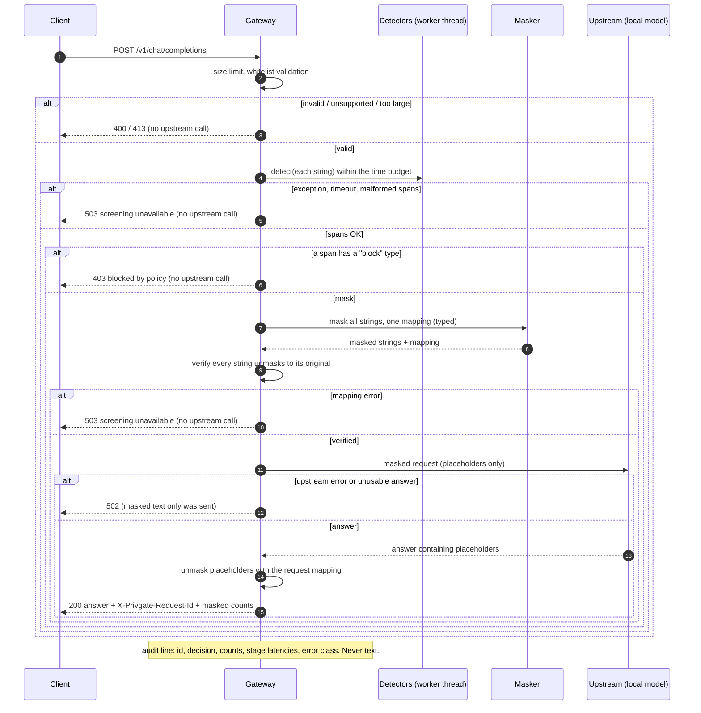

# The gateway

An HTTP service that screens and masks every message **before** it may reach a language model,
restores the original values in the model's answer, and **fails closed**: if anything in the
screening path is uncertain, the request is blocked and nothing is sent upstream.

Results of the two experiments (RQ9 fault injection, RQ10 latency) are in
[results-gateway.md](results-gateway.md). Code: `src/privgate/gateway/`.

## Install and run

```text
pip install -e ".[gateway,ml,detectors,masking]"      # exact pins below
python -m privgate.gateway --upstream-url http://127.0.0.1:8080/v1 --detector crf+regex \
       --block CREDIT_CARD --audit-log logs/audit.jsonl
```

The gateway listens on `127.0.0.1:8088` by default and forwards to a **local**
OpenAI-compatible server. A non-localhost `--upstream-url` is refused unless
`--allow-non-local-upstream` is given. No API keys are handled in this version.

Installed versions of the optional `gateway` extra (pinned in `pyproject.toml`):

| package | version | note |
|---|---|---|
| fastapi | 0.142.4 | 0.159.x was under two weeks old when pinned |
| starlette | 1.7.0 | pulled in by fastapi, not pinned by us |
| uvicorn | 0.54.0 | |
| httpx | 0.28.1 | client for the local upstream and for the tests/experiments |
| psutil | 7.2.2 | only for the machine-idle check of the latency experiment |

Python API: `create_app(GatewayConfig(...), detector=..., upstream=..., audit=...)` returns a
FastAPI app. If no detector is passed, `GatewayConfig.detector_name` is built
(`regex`, `crf`, `crf+regex`, `crf+regex+presidio`, any `+` union of runnable detectors). If
that fails the app still starts but is **not ready**: `/healthz` answers 503 and every chat
request is blocked.

## API

`POST /v1/chat/completions` accepts a **subset** of the OpenAI request:

* `model` (short identifier: letters, digits, `. _ : / @ + -`; it is forwarded, so it is a data
  channel and is restricted), `messages`, `temperature` (0-2), `max_tokens` (1-8192);
  `stream` may only be `false`.
* each message has exactly `role` (`system`, `user`, `assistant`) and `content`: a string, or a
  list of `{"type": "text", "text": ...}` parts.
* **Everything else is refused with 400 and nothing is sent upstream**: unknown fields at any
  level, tools, `tool_choice`, function calls, `stream: true`, image/audio/file parts, `tool`
  or `function` roles, lone surrogates in text, NaN/Infinity.
* 413 if the body exceeds `max_request_bytes` (default 262,144; enforced while streaming the
  body, not only from `Content-Length`); 400 above `max_messages` (default 64).

The response is a whitelisted OpenAI-style object (`id`, `object`, `created`, `model`,
`choices[{index, message, finish_reason}]`, `usage`), with the placeholders of the typed mapping
replaced by the original values, the header `X-Privgate-Request-Id`, and a field

```json
"privgate": {"request_id": "…", "screened": true, "masked_entities": {"EMAIL": 1, "PERSON": 2}}
```

with counts only. `GET /healthz` reports detector readiness and the fail-open flag without
processing any text.

| status | meaning | upstream called? |
|---|---|---|
| 200 | screened, masked, answered | yes (masked) |
| 400 | invalid / unsupported request | no |
| 403 | the request contains a type whose policy is `block` | no |
| 413 | request too large | no |
| 502 | upstream failed or answered something unusable | yes (masked) |
| 503 | screening unavailable (any fail-closed rule below) | **no** |

## Policy

Per entity type the action is `mask` (default) or `block`. `Policy.blocking([...])` /
`--block LABEL` makes a request that contains a detected value of that type fail with 403.
Masking uses the **typed** strategy (`<PERSON_1>`, `<EMAIL_2>`, …; see
[results-masking.md](results-masking.md)): it is reversible, and RQ7 measured it next to the
other strategies. All strings of a request (every message, every role, earlier assistant turns
included, every text part) are masked in one pass, so a value gets the same placeholder
everywhere in the request. The per-request seed is derived from the request id.

## Fail-closed rules

Each rule has a unit test (`tests/test_gateway_screening.py`, over HTTP in
`tests/test_gateway_app.py`). All end in **503 "screening unavailable" and no upstream call**.

| rule | triggered by |
|---|---|
| `not_ready` | no detector could be loaded |
| `detector_error` | the detector raised anything |
| `detector_timeout` | screening the request exceeded the budget (default 2 s **per request**, summed over its strings; enforced with a worker thread) |
| `malformed_output` | the detector returned non-`Span` items, spans outside the text, or overlapping / unsorted spans |
| `mapping_error` | masking failed, the number of edits differs from the number of spans, placeholders are ambiguous, or a masked string does not unmask back to the original (placeholder collision) |
| `internal_error` | any other exception in the screening path |

Design notes:

* **Round-trip check.** Every masked string is unmasked with the request's mapping and must equal
  the original. A collision between a user-typed `<EMAIL_1>` and ours is handled by the masker
  (per-request tag, `<EMAIL_1#3fa9c2>`) and *verified* here.
* **Timeout.** A Python thread cannot be killed. The request is abandoned and blocked at the
  deadline, but a hung detector keeps its worker thread until it returns. With the default
  `detector_workers=1` (detectors are not documented as thread-safe) later requests then also
  time out and are blocked: **availability suffers, privacy does not**. The budget is a gateway
  setting; clients cannot lengthen it.
* **Upstream** is called from exactly one function (`_send` in `app.py`).
* **Audit failures** never turn into request failures (the audit writer swallows its own errors
  and logs only the exception class).

### The unsafe fail-open variant

`GatewayConfig(fail_open=True)` forwards the **original** text when screening fails. It exists
only so RQ9 can measure what fail-closed prevents. It is off by default, **`create_app` refuses
it unless `PRIVGATE_ALLOW_FAIL_OPEN_FOR_EXPERIMENTS=1` is set**, the CLI has no switch for it,
and it does not bypass the `block` policy. Never use it with real data.

## Audit log

One JSON line per request, built from an allowlist (`AuditRecord`): request id, UTC timestamp,
decision (`served`, `blocked_policy`, `rejected_invalid`, `screening_unavailable`,
`upstream_error`, …), HTTP status, **counts** per entity type, detector names, latency per stage
(`parse`, `detect`, `mask`, `upstream`, `unmask`, `total`, ms) and the **class name** of the
error. Never raw text, entity values, placeholders, the mapping, or exception messages (a
detector's message may quote the text). A test sends 50 requests carrying canary values through
success and every failure path and scans the audit file, the in-memory records and every
captured log record for them. The mapping lives only in the request handler's memory; a test
shows no reference to it survives the request, on success or failure.

## One request



## Threat model

**What the gateway protects against.** Detected personal data in *text* messages of the accepted
subset reaches the upstream only as typed placeholders; the original values stay in the memory of
one request. An accidental failure of the screening machinery (crash, hang, garbage output,
masking bug) cannot cause unscreened text to be sent (RQ9). Data cannot leave through fields the
detectors do not read: the request schema is a whitelist. The audit log and logs contain no
content.

**What it does NOT protect against.**

* **PII the detectors miss still leaks.** Masking is only as good as detection. With the best
  configuration (`crf+regex+presidio`, typed), RQ7 measured a character leakage of 0.050 on
  `nemotron_dev_2k`, 0.060 on `nemotron_test_5k` and **0.318 on `gretel_en_test`** (a different
  distribution); the lighter `regex+presidio` leaks 0.369 / 0.351 / 0.509. Those are the numbers
  to quote ([results-masking.md](results-masking.md), RQ7 and RQ8). The gateway cannot be better
  than its detector.
* **Quasi-identifiers and context.** Placeholders keep the structure and everything that is not
  recognised as PII (a job title, a rare disease, a small town) remains and can re-identify.
* **Images, files, audio, tools** are *refused*, not screened: there is no detector for them.
* **The upstream sees placeholders and types** (`<PERSON_1>` was mentioned twice, an `IBAN`
  exists) and everything undetected. It is expected to be local; `--allow-non-local-upstream`
  sends that to another machine.
* **The operator machine is trusted.** Anyone who can read the gateway's memory, the process, or
  the clear text on the client side defeats it. No authentication, TLS or rate limiting is
  implemented here: bind to localhost.
* **Answers are unmasked blindly**: a model that echoes or invents a placeholder gets the
  matching original of *this* request back, never another request's values.
* **Availability** is deliberately sacrificed for privacy: a hung or crashing detector blocks
  requests.
* **Not a compliance claim.** This is a research prototype measured on public and synthetic
  data.
