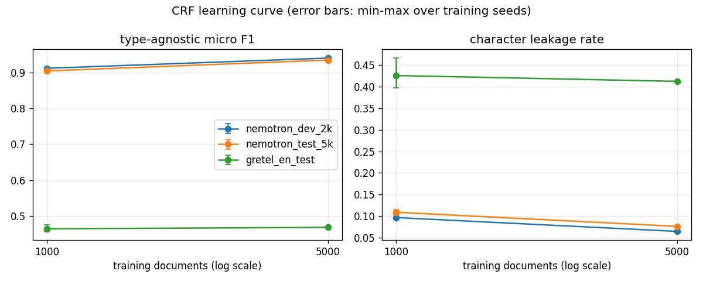

# Detection benchmark (Milestone 3)

## Research questions

- **RQ1** How well do a rule-based baseline and off-the-shelf NER/PII tools detect PII,
  under strict / partial / type-agnostic matching and character-level leakage?
- **RQ2** How does performance change from in-domain (dev) to domain-shifted (Nemotron test)
  to out-of-distribution data (Gretel)?
- **RQ3** Which entity types leak the most, and how much of the leakage comes from labels
  that no tested detector supports (e.g. OTHER: occupation, religious belief, passwords...)?

Every number on this page is generated by `scripts/make_detection_tables.py` from the
committed `results/m3/**/metrics.json`, `results/m3/presidio_sweep.json` and
`results/m3/run_log.json` (blocks between `<!-- name:begin -->` and `<!-- name:end -->`);
the prose contains no measured value. Reproduce:

```
pip install -e ".[dev,data,detectors]"
python scripts/install_model.py          # en_core_web_lg 3.8.0, hash-checked
python -m privgate.bench all             # all runs, sweep, ensembles, error samples
python scripts/make_detection_tables.py  # this page and docs/DETECTORS.md
```

## Setup

- **Evaluation sets** (docs/DATA.md): `nemotron_dev_2k` (in-domain dev), `nemotron_test_5k`
  (Nemotron test file: same generator, almost entirely different domains), `gretel_en_test`
  (Gretel finance, English: out-of-distribution). Each set's SHA-256 is checked against
  `data/manifest.json` before a run; a mismatch aborts it.
- **Detectors** (docs/DETECTORS.md): `regex` (Milestone 1 baseline), `spacy`
  (en_core_web_lg NER), `presidio` (Presidio Analyzer, default English recognizers, spaCy
  engine on the same model), and the union ensembles `regex+spacy`, `regex+presidio`
  (union of spans, then `resolve_overlaps`).
- **Metrics** (docs/theory/01-detection-metrics.md): micro P/R/F1 under strict, partial and
  type-agnostic matching; character-level recall, leakage rate (share of gold characters
  left visible) and precision. Two views: **all** gold spans (what actually leaks) and gold
  restricted to the detector's **supported** labels (is the tool good at what it claims).
  In the supported view predictions are unchanged, so a hit on an unsupported gold span is
  a false positive there.
- **Uncertainty**: 95% percentile bootstrap intervals, documents resampled with
  replacement, 1000 resamples, seed 0, standard library only. The same seed gives every
  detector the same resamples of a set (paired intervals).
- **Latency**: wall time around `detect()` per document, first 20 documents of each run
  excluded as warm-up; median, p95, mean, characters per second. Ensemble latency is the sum
  of its members' latencies plus the measured combination time. All runs on one laptop.

### Decisions fixed before any test-set result

1. **Presidio threshold** (code: `privgate.bench.sweep`, committed before the first run):
   sweep `score_threshold` in {0.0, 0.3, 0.4, 0.5, 0.6, 0.7, 0.85} on `nemotron_dev_2k`
   only; keep thresholds whose leakage rate is within 0.01 of the sweep minimum; choose the
   highest type-agnostic micro F1 among them (ties: lower threshold). The chosen value is
   used unchanged on both test sets. The benchmark refuses to run Presidio on a test set
   before the dev sweep exists.
2. **Best detector for RQ3**: lowest leakage rate on `nemotron_dev_2k` (all gold spans),
   ties broken by type-agnostic F1.
3. **"Supported" for RQ3** is decided per raw dataset label (`privgate.bench.support`): a
   raw label is targeted by a detector if its mapped type is in the detector's
   `supported_labels` and is not one of the heterogeneous types OTHER / ID_NUMBER, or if a
   native entity type of the detector is designed for it (e.g. Presidio `US_SSN` -> `ssn`,
   spaCy/Presidio `NORP`/`NRP` -> ethnicity, religion, political view). Emitting `OTHER` for
   nationalities does not make a detector a password detector. Each gold span's raw label
   is recovered from the pinned raw files (`privgate.bench.rawlabels`).

## RQ1: overall detection quality

<!-- rq1:begin -->
**All gold spans (privacy view)** (micro F1 and leakage with 95% bootstrap CI; latency = median ms per document)

| set | detector | strict F1 | partial F1 | type-agnostic F1 | leakage rate | char precision | median ms |
|---|---|---|---|---|---|---|---|
| `nemotron_dev_2k` | `regex` | 0.234 [0.225, 0.243] | 0.236 [0.227, 0.245] | 0.240 [0.231, 0.248] | 0.718 [0.708, 0.730] | 0.994 | 0.27 |
| `nemotron_dev_2k` | `spacy` | 0.350 [0.339, 0.361] | 0.417 [0.404, 0.428] | 0.551 [0.540, 0.562] | 0.654 [0.643, 0.666] | 0.661 | 34.7 |
| `nemotron_dev_2k` | `presidio` | 0.496 [0.486, 0.506] | 0.591 [0.581, 0.601] | 0.743 [0.735, 0.751] | 0.385 [0.374, 0.396] | 0.884 | 85.6 |
| `nemotron_dev_2k` | `regex+spacy` | 0.471 [0.460, 0.481] | 0.534 [0.523, 0.543] | 0.652 [0.643, 0.662] | 0.398 [0.386, 0.409] | 0.771 | 35.0 |
| `nemotron_dev_2k` | `regex+presidio` | 0.505 [0.496, 0.516] | 0.598 [0.588, 0.607] | 0.744 [0.736, 0.752] | 0.369 [0.358, 0.379] | 0.887 | 85.9 |
| `nemotron_test_5k` | `regex` | 0.225 [0.219, 0.231] | 0.226 [0.220, 0.232] | 0.232 [0.225, 0.239] | 0.723 [0.715, 0.729] | 0.968 | 0.27 |
| `nemotron_test_5k` | `spacy` | 0.357 [0.349, 0.364] | 0.422 [0.415, 0.429] | 0.556 [0.548, 0.562] | 0.655 [0.648, 0.662] | 0.673 | 34.1 |
| `nemotron_test_5k` | `presidio` | 0.506 [0.499, 0.512] | 0.604 [0.597, 0.610] | 0.755 [0.750, 0.760] | 0.364 [0.356, 0.371] | 0.869 | 84.9 |
| `nemotron_test_5k` | `regex+spacy` | 0.472 [0.465, 0.479] | 0.534 [0.528, 0.541] | 0.654 [0.648, 0.660] | 0.400 [0.393, 0.408] | 0.773 | 34.4 |
| `nemotron_test_5k` | `regex+presidio` | 0.514 [0.507, 0.521] | 0.609 [0.602, 0.616] | 0.756 [0.751, 0.761] | 0.351 [0.343, 0.357] | 0.871 | 85.3 |
| `gretel_en_test` | `regex` | 0.077 [0.070, 0.084] | 0.084 [0.076, 0.091] | 0.087 [0.079, 0.095] | 0.944 [0.939, 0.950] | 0.185 | 0.45 |
| `gretel_en_test` | `spacy` | 0.202 [0.194, 0.209] | 0.354 [0.344, 0.362] | 0.431 [0.421, 0.440] | 0.405 [0.395, 0.417] | 0.370 | 80.2 |
| `gretel_en_test` | `presidio` | 0.190 [0.182, 0.198] | 0.308 [0.298, 0.318] | 0.389 [0.379, 0.399] | 0.514 [0.503, 0.526] | 0.345 | 181.7 |
| `gretel_en_test` | `regex+spacy` | 0.220 [0.212, 0.227] | 0.367 [0.358, 0.375] | 0.441 [0.431, 0.449] | 0.353 [0.342, 0.364] | 0.350 | 80.9 |
| `gretel_en_test` | `regex+presidio` | 0.194 [0.187, 0.202] | 0.312 [0.302, 0.321] | 0.393 [0.382, 0.402] | 0.509 [0.498, 0.521] | 0.347 | 182.2 |

**Gold restricted to each detector's supported labels** (micro F1 and leakage with 95% bootstrap CI; latency = median ms per document)

| set | detector | strict F1 | partial F1 | type-agnostic F1 | leakage rate | char precision | median ms |
|---|---|---|---|---|---|---|---|
| `nemotron_dev_2k` | `regex` | 0.811 [0.800, 0.823] | 0.818 [0.807, 0.829] | 0.818 [0.807, 0.829] | 0.191 [0.177, 0.204] | 0.987 | 0.27 |
| `nemotron_dev_2k` | `spacy` | 0.435 [0.422, 0.449] | 0.518 [0.505, 0.530] | 0.618 [0.606, 0.629] | 0.463 [0.446, 0.480] | 0.574 | 34.7 |
| `nemotron_dev_2k` | `presidio` | 0.527 [0.517, 0.537] | 0.628 [0.619, 0.638] | 0.779 [0.771, 0.787] | 0.316 [0.304, 0.328] | 0.872 | 85.6 |
| `nemotron_dev_2k` | `regex+spacy` | 0.508 [0.497, 0.519] | 0.576 [0.565, 0.586] | 0.675 [0.665, 0.685] | 0.352 [0.339, 0.364] | 0.751 | 35.0 |
| `nemotron_dev_2k` | `regex+presidio` | 0.537 [0.527, 0.548] | 0.635 [0.626, 0.645] | 0.779 [0.772, 0.787] | 0.297 [0.286, 0.310] | 0.875 | 85.9 |
| `nemotron_test_5k` | `regex` | 0.818 [0.806, 0.828] | 0.824 [0.812, 0.834] | 0.824 [0.812, 0.834] | 0.181 [0.172, 0.191] | 0.959 | 0.27 |
| `nemotron_test_5k` | `spacy` | 0.439 [0.430, 0.446] | 0.519 [0.511, 0.527] | 0.619 [0.611, 0.626] | 0.473 [0.463, 0.483] | 0.583 | 34.1 |
| `nemotron_test_5k` | `presidio` | 0.526 [0.519, 0.532] | 0.627 [0.620, 0.634] | 0.780 [0.775, 0.785] | 0.311 [0.303, 0.318] | 0.864 | 84.9 |
| `nemotron_test_5k` | `regex+spacy` | 0.509 [0.502, 0.516] | 0.576 [0.569, 0.583] | 0.678 [0.672, 0.684] | 0.354 [0.346, 0.362] | 0.752 | 34.4 |
| `nemotron_test_5k` | `regex+presidio` | 0.534 [0.527, 0.541] | 0.632 [0.626, 0.639] | 0.781 [0.775, 0.786] | 0.297 [0.289, 0.304] | 0.866 | 85.3 |
| `gretel_en_test` | `regex` | 0.336 [0.306, 0.366] | 0.364 [0.334, 0.397] | 0.365 [0.335, 0.397] | 0.393 [0.355, 0.429] | 0.181 | 0.45 |
| `gretel_en_test` | `spacy` | 0.210 [0.203, 0.218] | 0.369 [0.359, 0.378] | 0.442 [0.432, 0.452] | 0.336 [0.326, 0.347] | 0.366 | 80.2 |
| `gretel_en_test` | `presidio` | 0.209 [0.201, 0.217] | 0.338 [0.328, 0.349] | 0.413 [0.402, 0.423] | 0.356 [0.345, 0.368] | 0.336 | 181.7 |
| `gretel_en_test` | `regex+spacy` | 0.222 [0.215, 0.230] | 0.372 [0.362, 0.380] | 0.443 [0.434, 0.452] | 0.339 [0.329, 0.350] | 0.348 | 80.9 |
| `gretel_en_test` | `regex+presidio` | 0.213 [0.205, 0.222] | 0.343 [0.332, 0.353] | 0.416 [0.405, 0.426] | 0.349 [0.338, 0.361] | 0.338 | 182.2 |
<!-- rq1:end -->

## RQ2: dev -> domain-shifted test -> out-of-distribution

<!-- rq2:begin -->
All gold spans; dev = `nemotron_dev_2k`, test = `nemotron_test_5k`, gretel = `gretel_en_test`.

| detector | strict F1 dev | strict F1 test | strict F1 gretel | type-agnostic F1 dev | type-agnostic F1 test | type-agnostic F1 gretel | leakage dev | leakage test | leakage gretel |
|---|---|---|---|---|---|---|---|---|---|
| `regex` | 0.234 | 0.225 | 0.077 | 0.240 [0.231, 0.248] | 0.232 [0.225, 0.239] | 0.087 [0.079, 0.095] | 0.718 [0.708, 0.730] | 0.723 [0.715, 0.729] | 0.944 [0.939, 0.950] |
| `spacy` | 0.350 | 0.357 | 0.202 | 0.551 [0.540, 0.562] | 0.556 [0.548, 0.562] | 0.431 [0.421, 0.440] | 0.654 [0.643, 0.666] | 0.655 [0.648, 0.662] | 0.405 [0.395, 0.417] |
| `presidio` | 0.496 | 0.506 | 0.190 | 0.743 [0.735, 0.751] | 0.755 [0.750, 0.760] | 0.389 [0.379, 0.399] | 0.385 [0.374, 0.396] | 0.364 [0.356, 0.371] | 0.514 [0.503, 0.526] |
| `regex+spacy` | 0.471 | 0.472 | 0.220 | 0.652 [0.643, 0.662] | 0.654 [0.648, 0.660] | 0.441 [0.431, 0.449] | 0.398 [0.386, 0.409] | 0.400 [0.393, 0.408] | 0.353 [0.342, 0.364] |
| `regex+presidio` | 0.505 | 0.514 | 0.194 | 0.744 [0.736, 0.752] | 0.756 [0.751, 0.761] | 0.393 [0.382, 0.402] | 0.369 [0.358, 0.379] | 0.351 [0.343, 0.357] | 0.509 [0.498, 0.521] |
<!-- rq2:end -->

## RQ3: what leaks

<!-- rq3:begin -->
Best detector (lowest leakage on `nemotron_dev_2k`, chosen on dev): `regex+presidio`.

Leakage rate per gold label (share of that label's characters left visible, of N gold characters):

| gold label | nemotron_dev_2k | nemotron_test_5k | gretel_en_test |
|---|---|---|---|
| PERSON | 11.3% of 14,222 | 12.4% of 48,379 | 23.7% of 57,163 |
| EMAIL | 0.2% of 23,937 | 0.3% of 69,544 | 5.9% of 7,672 |
| PHONE | 3.8% of 8,830 | 2.6% of 19,307 | 8.0% of 6,980 |
| CREDIT_CARD | 51.9% of 3,848 | 44.2% of 12,403 | 38.1% of 1,415 |
| IBAN | -- | -- | 2.8% of 1,549 |
| IP_ADDRESS | 10.6% of 6,039 | 4.7% of 10,357 | 1.8% of 3,187 |
| URL | 0.8% of 43,633 | 0.6% of 93,130 | -- |
| DATE | 5.7% of 25,082 | 6.2% of 59,143 | 7.9% of 14,679 |
| LOCATION | 40.0% of 19,350 | 40.1% of 51,472 | 55.6% of 64,333 |
| ORGANIZATION | 92.8% of 28,232 | 95.8% of 49,533 | 95.1% of 61,702 |
| ID_NUMBER | 45.6% of 23,733 | 36.3% of 58,668 | 48.0% of 6,060 |
| OTHER | 77.4% of 52,684 | 78.0% of 137,803 | 60.8% of 7,514 |

Share of all leaked gold characters that belong to raw labels NO tested detector targets:

| detector | nemotron_dev_2k | nemotron_test_5k | gretel_en_test |
|---|---|---|---|
| `regex` | 35.3% (63,297 of 179,294) | 35.2% (155,160 of 440,593) | 3.3% (7,301 of 219,347) |
| `spacy` | 33.7% (55,080 of 163,239) | 34.3% (136,800 of 399,293) | 7.1% (6,681 of 94,156) |
| `presidio` | 50.1% (48,094 of 96,077) | 52.7% (116,741 of 221,686) | 4.2% (5,075 of 119,464) |
| `regex+spacy` | 55.3% (54,937 of 99,292) | 55.9% (136,506 of 244,188) | 8.1% (6,649 of 81,983) |
| `regex+presidio` | 52.3% (48,094 of 91,980) | 54.6% (116,687 of 213,782) | 4.3% (5,075 of 118,286) |

Raw labels leaking the most characters for `regex+presidio` on `nemotron_dev_2k` (top 12):

| raw label | mapped | targeted by some detector | leaked chars | share of leaked | leakage rate |
|---|---|---|---|---|---|
| `company_name` | ORGANIZATION | yes | 26,208 | 28.5% | 92.8% |
| `occupation` | OTHER | no | 11,254 | 12.2% | 99.5% |
| `http_cookie` | OTHER | no | 9,268 | 10.1% | 87.4% |
| `api_key` | OTHER | no | 4,126 | 4.5% | 97.4% |
| `education_level` | OTHER | no | 3,608 | 3.9% | 97.0% |
| `street_address` | LOCATION | yes | 3,368 | 3.7% | 57.5% |
| `vehicle_identifier` | ID_NUMBER | no | 2,844 | 3.1% | 93.9% |
| `coordinate` | LOCATION | yes | 2,586 | 2.8% | 77.8% |
| `credit_debit_card` | CREDIT_CARD | yes | 1,997 | 2.2% | 51.9% |
| `password` | OTHER | no | 1,806 | 2.0% | 93.0% |
| `user_name` | OTHER | no | 1,727 | 1.9% | 61.3% |
| `device_identifier` | OTHER | no | 1,655 | 1.8% | 74.7% |
<!-- rq3:end -->

<!-- support:begin -->
Raw labels targeted by NO tested detector (derived from `supported_labels` and `privgate.bench.support.NATIVE_RAW_TARGETS`):

- nemotron-pii: `age`, `api_key`, `bank_routing_number`, `biometric_identifier`, `blood_type`, `certificate_license_number`, `customer_id`, `cvv`, `device_identifier`, `education_level`, `employee_id`, `employment_status`, `gender`, `health_plan_beneficiary_number`, `http_cookie`, `language`, `license_plate`, `medical_record_number`, `national_id`, `occupation`, `password`, `pin`, `sexuality`, `swift_bic`, `unique_id`, `user_name`, `vehicle_identifier`
- gretel-finance-en: `account_pin`, `api_key`, `bank_routing_number`, `credit_card_security_code`, `customer_id`, `employee_id`, `password`, `swift_bic_code`, `user_name`

Explicit raw-label targets of native types inside OTHER / ID_NUMBER:

- `regex`: none
- `spacy`: TIME -> time; NORP -> political_view, race_ethnicity, religious_belief
- `presidio`: DATE_TIME -> time; NRP -> political_view, race_ethnicity, religious_belief; MAC_ADDRESS -> mac_address; US_SSN -> ssn; US_PASSPORT -> passport_number; US_DRIVER_LICENSE -> driver_license_number; US_BANK_NUMBER -> account_number, bban; US_ITIN -> tax_id
<!-- support:end -->

## Presidio threshold selection (dev only)

<!-- sweep:begin -->
Set: `nemotron_dev_2k` (all gold spans). Rule: On nemotron_dev_2k (all gold spans): keep thresholds whose leakage_rate is within 0.01 of the minimum leakage_rate over [0.0, 0.3, 0.4, 0.5, 0.6, 0.7, 0.85]; choose the highest type-agnostic micro F1 among them; ties go to the lower threshold.

| threshold | pred spans | strict F1 | partial F1 | TA precision | TA recall | TA F1 | leakage | char precision | eligible |
|---|---|---|---|---|---|---|---|---|---|
| 0.00 | 11,718 | 0.496 | 0.591 | 0.866 | 0.652 | 0.743 | 0.385 | 0.884 | yes |
| 0.30 | 11,194 | 0.496 | 0.584 | 0.870 | 0.625 | 0.728 | 0.399 | 0.883 | no |
| 0.40 | 10,791 | 0.487 | 0.575 | 0.876 | 0.607 | 0.717 | 0.410 | 0.883 | no |
| 0.50 | 10,061 | 0.473 | 0.556 | 0.869 | 0.562 | 0.682 | 0.439 | 0.878 | no |
| 0.60 | 9,868 | 0.475 | 0.556 | 0.871 | 0.552 | 0.676 | 0.452 | 0.879 | no |
| 0.70 | 9,015 | 0.450 | 0.511 | 0.862 | 0.499 | 0.632 | 0.562 | 0.858 | no |
| 0.85 | 8,594 | 0.429 | 0.490 | 0.855 | 0.472 | 0.609 | 0.584 | 0.852 | no |

Minimum leakage 0.385; eligible thresholds 0.00; **selected threshold: 0.00**, used unchanged on `nemotron_test_5k` and `gretel_en_test`.
<!-- sweep:end -->

## Latency and runtime

<!-- latency:begin -->
Machine: AMD Ryzen 5 7540U w/ Radeon 740M Graphics (12 logical CPUs), Windows-10-10.0.26200-SP0, Python 3.10.11. Latency depends on this laptop and its load; compare detectors within this table only.

| set | detector | median ms | p95 ms | mean ms | chars/s |
|---|---|---|---|---|---|
| `nemotron_dev_2k` | `regex` | 0.27 | 0.91 | 0.36 | 2,739,889 |
| `nemotron_dev_2k` | `spacy` | 34.7 | 108.1 | 44.3 | 22,173 |
| `nemotron_dev_2k` | `presidio` | 85.6 | 258.8 | 109.7 | 8,955 |
| `nemotron_dev_2k` | `regex+spacy` | 35.0 | 109.2 | 44.7 | 21,979 |
| `nemotron_dev_2k` | `regex+presidio` | 85.9 | 259.7 | 110.1 | 8,923 |
| `nemotron_test_5k` | `regex` | 0.27 | 0.88 | 0.36 | 2,667,231 |
| `nemotron_test_5k` | `spacy` | 34.1 | 103.0 | 42.7 | 22,274 |
| `nemotron_test_5k` | `presidio` | 84.9 | 251.4 | 106.6 | 8,930 |
| `nemotron_test_5k` | `regex+spacy` | 34.4 | 104.0 | 43.1 | 22,074 |
| `nemotron_test_5k` | `regex+presidio` | 85.3 | 252.0 | 107.0 | 8,896 |
| `gretel_en_test` | `regex` | 0.45 | 0.86 | 0.47 | 3,011,398 |
| `gretel_en_test` | `spacy` | 80.2 | 121.4 | 78.0 | 18,118 |
| `gretel_en_test` | `presidio` | 181.7 | 265.7 | 176.7 | 7,997 |
| `gretel_en_test` | `regex+spacy` | 80.9 | 122.4 | 78.5 | 17,993 |
| `gretel_en_test` | `regex+presidio` | 182.2 | 266.5 | 177.2 | 7,973 |
<!-- latency:end -->

<!-- runtime:begin -->
Total wall time of all benchmark steps: 32.5 min (detect 30.4 min, ensemble 0.0 min, errors 0.0 min, score 1.8 min, sweep 0.1 min); from `results/m3/run_log.json`. Model loading is included in `detect`.
<!-- runtime:end -->

## Observations

Generated from the tables above; neutral statements of what was measured.

<!-- observations:begin -->
- `nemotron_dev_2k`: lowest leakage `regex+presidio` 0.369 [0.358, 0.379], next `presidio` 0.385 [0.374, 0.396] (intervals overlap); highest type-agnostic F1 `regex+presidio` 0.744.
- `nemotron_test_5k`: lowest leakage `regex+presidio` 0.351 [0.343, 0.357], next `presidio` 0.364 [0.356, 0.371] (intervals overlap); highest type-agnostic F1 `regex+presidio` 0.756.
- `gretel_en_test`: lowest leakage `regex+spacy` 0.353 [0.342, 0.364], next `spacy` 0.405 [0.395, 0.417] (intervals do not overlap); highest type-agnostic F1 `regex+spacy` 0.441.
- `regex`: type-agnostic F1 dev -> test -> gretel 0.240 -> 0.232 -> 0.087; leakage 0.718 -> 0.723 -> 0.944; dev leakage on its supported labels only 0.191.
- `spacy`: type-agnostic F1 dev -> test -> gretel 0.551 -> 0.556 -> 0.431; leakage 0.654 -> 0.655 -> 0.405; dev leakage on its supported labels only 0.463.
- `presidio`: type-agnostic F1 dev -> test -> gretel 0.743 -> 0.755 -> 0.389; leakage 0.385 -> 0.364 -> 0.514; dev leakage on its supported labels only 0.316.
- `regex+spacy`: type-agnostic F1 dev -> test -> gretel 0.652 -> 0.654 -> 0.441; leakage 0.398 -> 0.400 -> 0.353; dev leakage on its supported labels only 0.352.
- `regex+presidio`: type-agnostic F1 dev -> test -> gretel 0.744 -> 0.756 -> 0.393; leakage 0.369 -> 0.351 -> 0.509; dev leakage on its supported labels only 0.297.
- `regex+presidio` on `nemotron_dev_2k`: 52.3% of the leaked gold characters belong to raw labels no tested detector targets.
- `regex+presidio` on `nemotron_test_5k`: 54.6% of the leaked gold characters belong to raw labels no tested detector targets.
- `regex+presidio` on `gretel_en_test`: 4.3% of the leaked gold characters belong to raw labels no tested detector targets.
- Presidio threshold selected on dev: 0.00.
<!-- observations:end -->

Reading notes (no numbers; see the tables):

- The two views answer different questions. The regex baseline scores far better on its
  supported labels than on all gold spans, because it targets only six structured types;
  the gap between the views is the part of the problem a tool does not even attempt.
- Gretel has no URL gold label and labels fewer entities per character than Nemotron, so
  URLs and other strings that detectors flag there count as false positives. This lowers
  character precision on Gretel for every detector and is a property of the annotation, not
  necessarily of the detector.
- Presidio's default configuration ignores ORGANIZATION, so organisation names leak almost
  entirely in every Presidio-based run; the spaCy-based runs do report organisations.
- Most leaked characters in the Nemotron sets of the best detector belong either to
  organisation names or to raw labels no tested detector targets (occupations, cookies,
  API keys, education levels, ...): better tuning of the same tools cannot remove that part.

Error samples (15 false negatives and 15 false positives per detector on `nemotron_dev_2k`,
type-agnostic, seed 0) are in `results/m3/errors_<detector>.md`.

## Threats to validity

- **Synthetic data.** Both datasets are generated; their text is more regular than real
  documents and their labels come from the generator (Nemotron) or from an NER pass plus
  LLM filtering (Gretel). A detector's "false positive" can be real but unlabelled PII.
- **Label-mapping choices.** Detector and dataset labels are mapped onto privgate's types by
  hand (docs/DATA.md, docs/DETECTORS.md). Strict and partial scores depend on these choices;
  type-agnostic and character-level scores do not.
- **OTHER is heterogeneous.** OTHER groups occupations, passwords, demographic attributes,
  times of day and more. A detector "supporting" OTHER covers only a few of them, which is
  why RQ3 is answered per raw label; per-type OTHER scores mix very different things.
- **Presidio defaults are US-centric.** Its default identifier recognizers are mostly US
  formats (SSN, ITIN, passport, driver's licence, bank number) plus a few UK/medical ones;
  `intl` Nemotron documents and other identifier formats are not targeted. Its spaCy-based
  recognizer ignores ORGANIZATION by default. No recognizer was tuned or added.
- **Single threshold, single configuration.** Only Presidio's score threshold was selected
  (on dev); all other settings are library defaults.
- **Ensembles are unions.** They maximise coverage by construction; precision is not
  optimised.
- **Single-laptop latency.** Timings come from one Windows laptop under normal desktop load;
  they rank detectors within this run and are not absolute performance figures.
- **Dev selection is not independent of dev scores.** Dev numbers for Presidio are those of
  the threshold chosen on dev and are optimistic for that reason; test-set numbers are not.

# Milestone 4: a detector trained on the Nemotron train split

## Research questions

- **RQ4** Does a supervised sequence model trained on the Nemotron train split reduce
  leakage compared with the best off-the-shelf detector (`regex+presidio`), in-domain
  (dev), domain-shifted (Nemotron test) and out-of-distribution (Gretel)?
- **RQ5** How does performance grow with the amount of training data (learning curve)?
- **RQ6** What do transition features add? (CRF vs a per-token logistic regression with
  the same features: ablation)
- **Card puzzle (from Milestone 3)**: what fraction of gold CREDIT_CARD spans pass the Luhn
  check in each set?

Every number below is generated by `scripts/make_detection_tables.py` (Milestone 4 blocks in
`scripts/m4_tables.py`) from committed files in `results/m4/` and `results/m3/`. Reproduce:

```
pip install -e ".[dev,data,detectors,ml,plots]"
python scripts/m4_analysis.py alignment && python scripts/m4_analysis.py cards
python scripts/train_ml.py subsets && python scripts/train_ml.py grid
python scripts/train_ml.py curve && python scripts/train_ml.py final
python -m privgate.bench --out results/m4 --members-root results/m3 run --set <set> --detector crf
python -m privgate.bench --out results/m4 --members-root results/m3 run --set <set> --detector logreg
python -m privgate.bench --out results/m4 --members-root results/m3 ensemble --set <set> --detector crf+regex+presidio
python -m privgate.bench --out results/m4 --members-root results/m3 compare --set <set> --a crf --b regex+presidio
python scripts/m4_analysis.py weights && python scripts/m4_analysis.py curve
python scripts/make_detection_tables.py
```

## Method

- **Models** (docs/theory/02-crf.md): a linear-chain CRF (sklearn-crfsuite, L-BFGS,
  L1 + L2, 100 iterations, all possible transitions) and, as ablation, a per-token
  multinomial logistic regression on exactly the same features (privgate.ml.features:
  word, shapes, affixes, flags and a +-2 window, plus the regex baseline's label as a
  stacked feature). Tokens are word runs and single punctuation marks; spans are encoded
  as BIO tags over the 12 types; invalid sequences are repaired (an orphan `I-` starts a
  span).
- **Training pool**: Nemotron train split only. Every training document is checked against
  the three evaluation sets and the split rule before training (`check_training_pool`).
  Subsets are drawn by persona group (both renderings of a persona together); seeds 0, 1, 2
  for n = 1000 and seed 0 for n = 5000 (see deviations).
- **Selection on dev only**: CRF `c1` x `c2` grid and LogReg `C` grid on `nemotron_dev_2k`
  by type-agnostic micro F1 (ties: lower leakage); the CRF training size used in the
  benchmark is the one with the highest mean dev F1 over seeds. Test sets are scored only
  after these choices; learning-curve test scores choose nothing.
- **Evaluation**: the Milestone 3 benchmark unchanged (same CLI, metrics, views, bootstrap
  CIs, latency, hash checks). `crf+regex+presidio` is the union of the CRF with the stored
  Milestone 3 `regex` and `presidio` runs. Comparisons with `regex+presidio` are paired:
  both systems on the same 1000 document resamples (seed 0).

### Deviations from the plan, decided from measured cost

- **n = 20000 was not trained**, and the hyper-parameter grids were trained on n = 1000
  instead of n = 5000 (decided before any evaluation). A timing probe on 1000 train-split
  documents and the memory then available on this laptop showed that one n = 5000 CRF
  needs most of the free memory and a large share of the time budget, so nine of them
  (the grid) or one n = 20000 model do not fit; the measured cost of every trained model
  is in the table below.
- **n = 5000 was trained with seed 0 only** instead of seeds 0, 1, 2. This was decided
  after the n = 1000 curve runs, from their measured peak memory (one n = 5000 process
  cannot share the free memory with another) and training time (three sequential n = 5000
  models would double the budget). Those n = 1000 runs had already been scored, test sets
  included, as part of the learning curve; the decision rests on the cost figures, not on
  scores, but it was not made blind. The n = 5000 row of the learning curve therefore has
  no seed spread.
- n = 1000 models (grid and seeds) were trained three at a time in separate processes;
  n = 5000 models one at a time. Training is deterministic, so this changes no result.
- The grid runs recorded no peak memory (a Windows ctypes declaration bug in the memory
  probe, fixed before the learning-curve runs); their memory cells read NOT MEASURED.

## Tokenisation ceiling (alignment loss)

<!-- m4_alignment:begin -->
Gold spans -> BIO tags -> spans, scored against the gold spans (the best any token tagger can do with this tokeniser):

| set | gold spans | spans after round trip | documents changed | strict F1 | partial F1 | type-agnostic F1 | leakage | char precision |
|---|---|---|---|---|---|---|---|---|
| `nemotron_dev_2k` | 15,567 | 15,567 | 18 of 2,000 | 0.997 | 1.000 | 1.000 | 0.000 | 1.000 |
| `nemotron_test_5k` | 40,000 | 39,979 | 50 of 5,000 | 0.997 | 1.000 | 1.000 | 0.000 | 1.000 |
| `gretel_en_test` | 12,719 | 12,718 | 47 of 2,891 | 0.994 | 1.000 | 1.000 | 0.000 | 0.993 |
<!-- m4_alignment:end -->

## Card puzzle: do the gold card numbers pass Luhn?

<!-- m4_cards:begin -->
Gold CREDIT_CARD spans, digits only:

| set | gold card spans | pass Luhn | pass rate | 13-19 digits | 13-19 digits and Luhn |
|---|---|---|---|---|---|
| `nemotron_dev_2k` | 205 | 22 | 10.7% | 204 | 22 |
| `nemotron_test_5k` | 668 | 70 | 10.5% | 665 | 70 |
| `gretel_en_test` | 83 | 47 | 56.6% | 79 | 44 |

For comparison, `regex+presidio` leaks this share of gold card characters:

| set | CREDIT_CARD leakage |
|---|---|
| `nemotron_dev_2k` | 51.9% |
| `nemotron_test_5k` | 44.2% |
| `gretel_en_test` | 38.1% |
<!-- m4_cards:end -->

## Selection on dev and training cost

<!-- m4_training:begin -->
CRF grid on `nemotron_dev_2k` (n = 1000, seed 0); rule: highest dev type-agnostic micro F1; ties -> lower leakage, smaller c1, c2.

| c1 | c2 | dev TA F1 | dev leakage | dev strict F1 | train s | peak MB |  |
|---|---|---|---|---|---|---|---|
| 0.05 | 0.01 | 0.909 | 0.095 | 0.847 | 264 | NOT MEASURED |  |
| 0.05 | 0.05 | 0.908 | 0.101 | 0.850 | 265 | NOT MEASURED |  |
| 0.05 | 0.1 | 0.908 | 0.101 | 0.850 | 268 | NOT MEASURED |  |
| 0.1 | 0.01 | 0.911 | 0.092 | 0.848 | 257 | NOT MEASURED | **selected** |
| 0.1 | 0.05 | 0.909 | 0.095 | 0.850 | 256 | NOT MEASURED |  |
| 0.1 | 0.1 | 0.908 | 0.097 | 0.849 | 255 | NOT MEASURED |  |
| 0.3 | 0.01 | 0.910 | 0.093 | 0.845 | 254 | NOT MEASURED |  |
| 0.3 | 0.05 | 0.908 | 0.099 | 0.847 | 253 | NOT MEASURED |  |
| 0.3 | 0.1 | 0.908 | 0.099 | 0.847 | 251 | NOT MEASURED |  |

LogReg grid on `nemotron_dev_2k` (n = 1000, seed 0); rule: highest dev type-agnostic micro F1; ties -> lower leakage, smaller C.

| C | dev TA F1 | dev leakage | dev strict F1 | iterations | train s | peak MB |  |
|---|---|---|---|---|---|---|---|
| 0.1 | 0.856 | 0.141 | 0.698 | 58 | 110 | NOT MEASURED |  |
| 1.0 | 0.860 | 0.115 | 0.705 | 77 | 132 | NOT MEASURED | **selected** |
| 10.0 | 0.849 | 0.111 | 0.684 | 78 | 132 | NOT MEASURED |  |
<!-- m4_training:end -->

<!-- m4_cost:begin -->
Training cost of every model on this laptop (peak MB = peak working set of the training process):

| n (documents) | seed | train s | peak MB | eval s (3 sets) |
|---|---|---|---|---|
| 1000 | 0 | 230 | 792 | 117 |
| 1000 | 1 | 216 | 791 | 117 |
| 1000 | 2 | 259 | 789 | 119 |
| 5000 | 0 | 1239 | 1421 | 112 |
| 5000 (LogReg, C=1.0) | 0 | 616 | 4118 | -- |

**Largest feasible n: 5000.** n = 20000 was not trained: scaling the measured n = 5000 cost linearly (an extrapolation, NOT a measurement) gives about 83 min and 5.6 GB for one model. Total wall time of all training steps: 59.4 min (`results/m4/training_log.json`).
<!-- m4_cost:end -->

## RQ5: learning curve



<!-- m4_curve:begin -->
CRF with c1 = 0.1, c2 = 0.01 (selected on dev); mean over training seeds [min, max]. Figure: `docs/figures/m4_learning_curve.png`.

| n | set | seeds | type-agnostic F1 | leakage | strict F1 |
|---|---|---|---|---|---|
| 1000 | `nemotron_dev_2k` | 3 | 0.912 [0.910, 0.914] | 0.097 [0.092, 0.104] | 0.851 |
| 1000 | `nemotron_test_5k` | 3 | 0.904 [0.902, 0.906] | 0.109 [0.103, 0.115] | 0.841 |
| 1000 | `gretel_en_test` | 3 | 0.464 [0.457, 0.476] | 0.426 [0.397, 0.466] | 0.207 |
| 5000 | `nemotron_dev_2k` | 1 | 0.940 [0.940, 0.940] | 0.065 [0.065, 0.065] | 0.898 |
| 5000 | `nemotron_test_5k` | 1 | 0.935 [0.935, 0.935] | 0.076 [0.076, 0.076] | 0.893 |
| 5000 | `gretel_en_test` | 1 | 0.468 [0.468, 0.468] | 0.412 [0.412, 0.412] | 0.243 |

Size used in the benchmark (rule: size with the highest mean dev type-agnostic F1): n = 5000, seed 0.
<!-- m4_curve:end -->

## RQ4: trained CRF vs the best off-the-shelf detector

<!-- m4_rq4:begin -->
All gold spans; 95% bootstrap CI; latency = median ms per document.

| set | detector | strict F1 | type-agnostic F1 | leakage | char precision | median ms |
|---|---|---|---|---|---|---|
| `nemotron_dev_2k` | `regex+presidio` | 0.505 [0.496, 0.516] | 0.744 [0.736, 0.752] | 0.369 [0.358, 0.379] | 0.887 | 85.9 |
| `nemotron_dev_2k` | `crf` | 0.898 [0.892, 0.905] | 0.940 [0.936, 0.945] | 0.065 [0.059, 0.071] | 0.970 | 8.2 |
| `nemotron_dev_2k` | `logreg` | 0.786 [0.777, 0.797] | 0.900 [0.894, 0.906] | 0.074 [0.068, 0.080] | 0.970 | 38.4 |
| `nemotron_dev_2k` | `crf+regex+presidio` | 0.812 [0.805, 0.820] | 0.916 [0.911, 0.922] | 0.050 [0.045, 0.055] | 0.903 | 94.1 |
| `nemotron_test_5k` | `regex+presidio` | 0.514 [0.507, 0.521] | 0.756 [0.751, 0.761] | 0.351 [0.343, 0.357] | 0.871 | 85.3 |
| `nemotron_test_5k` | `crf` | 0.893 [0.888, 0.898] | 0.935 [0.932, 0.938] | 0.076 [0.072, 0.081] | 0.961 | 7.3 |
| `nemotron_test_5k` | `logreg` | 0.784 [0.776, 0.791] | 0.897 [0.893, 0.901] | 0.087 [0.083, 0.091] | 0.962 | 38.1 |
| `nemotron_test_5k` | `crf+regex+presidio` | 0.802 [0.796, 0.808] | 0.910 [0.906, 0.914] | 0.060 [0.056, 0.064] | 0.888 | 93.0 |
| `gretel_en_test` | `regex+presidio` | 0.194 [0.187, 0.202] | 0.393 [0.382, 0.402] | 0.509 [0.498, 0.521] | 0.347 | 182.2 |
| `gretel_en_test` | `crf` | 0.243 [0.234, 0.252] | 0.468 [0.458, 0.479] | 0.412 [0.400, 0.423] | 0.383 | 14.8 |
| `gretel_en_test` | `logreg` | 0.105 [0.099, 0.112] | 0.339 [0.327, 0.350] | 0.423 [0.411, 0.434] | 0.358 | 53.9 |
| `gretel_en_test` | `crf+regex+presidio` | 0.223 [0.215, 0.231] | 0.423 [0.414, 0.433] | 0.318 [0.306, 0.331] | 0.341 | 198.2 |

Paired differences against `regex+presidio` (A - B; same document resamples, 1000, seed 0; negative leakage delta = A leaks less):

| comparison | set | leakage delta [CI] | CI excludes 0 | type-agnostic F1 delta [CI] | CI excludes 0 |
|---|---|---|---|---|---|
| `crf` - `regex+presidio` | `nemotron_dev_2k` | -0.304 [-0.316, -0.293] | yes | +0.196 [+0.189, +0.204] | yes |
| `crf` - `regex+presidio` | `nemotron_test_5k` | -0.274 [-0.281, -0.267] | yes | +0.179 [+0.173, +0.183] | yes |
| `crf` - `regex+presidio` | `gretel_en_test` | -0.097 [-0.108, -0.086] | yes | +0.075 [+0.067, +0.084] | yes |
| `crf+regex+presidio` - `regex+presidio` | `nemotron_dev_2k` | -0.319 [-0.330, -0.308] | yes | +0.172 [+0.166, +0.178] | yes |
| `crf+regex+presidio` - `regex+presidio` | `nemotron_test_5k` | -0.291 [-0.297, -0.284] | yes | +0.154 [+0.150, +0.158] | yes |
| `crf+regex+presidio` - `regex+presidio` | `gretel_en_test` | -0.191 [-0.199, -0.183] | yes | +0.031 [+0.025, +0.036] | yes |
<!-- m4_rq4:end -->

<!-- m4_perlabel:begin -->
Leakage rate per gold label, `crf` / `regex+presidio`:

| gold label | nemotron_dev_2k | nemotron_test_5k | gretel_en_test |
|---|---|---|---|
| PERSON | 10.8% / 11.3% | 9.1% / 12.4% | 31.6% / 23.7% |
| EMAIL | 0.4% / 0.2% | 0.3% / 0.3% | 6.2% / 5.9% |
| PHONE | 0.1% / 3.8% | 0.3% / 2.6% | 24.8% / 8.0% |
| CREDIT_CARD | 0.0% / 51.9% | 0.1% / 44.2% | 6.0% / 38.1% |
| IBAN | -- / -- | -- / -- | 25.2% / 2.8% |
| IP_ADDRESS | 1.2% / 10.6% | 0.6% / 4.7% | 1.4% / 1.8% |
| URL | 1.2% / 0.8% | 1.2% / 0.6% | -- / -- |
| DATE | 4.1% / 5.7% | 3.6% / 6.2% | 10.0% / 7.9% |
| LOCATION | 6.7% / 40.0% | 7.3% / 40.1% | 29.4% / 55.6% |
| ORGANIZATION | 8.0% / 92.8% | 20.2% / 95.8% | 81.0% / 95.1% |
| ID_NUMBER | 2.4% / 45.6% | 1.2% / 36.3% | 27.7% / 48.0% |
| OTHER | 16.7% / 77.4% | 17.4% / 78.0% | 38.2% / 60.8% |
<!-- m4_perlabel:end -->

## RQ6: what transitions add (CRF vs per-token logistic regression)

<!-- m4_rq6:begin -->
Same features; CRF n = 5000 (c1 = 0.1, c2 = 0.01), LogReg n = 5000 (C = 1.0); values CRF / LogReg; paired deltas CRF - LogReg with 95% CI.

| set | strict F1 | partial F1 | type-agnostic F1 | leakage | TA F1 delta [CI] | leakage delta [CI] |
|---|---|---|---|---|---|---|
| `nemotron_dev_2k` | 0.898 / 0.786 | 0.922 / 0.885 | 0.940 / 0.900 | 0.065 / 0.074 | +0.040 [+0.036, +0.045] | -0.009 [-0.013, -0.006] |
| `nemotron_test_5k` | 0.893 / 0.784 | 0.915 / 0.878 | 0.935 / 0.897 | 0.076 / 0.087 | +0.038 [+0.035, +0.041] | -0.010 [-0.013, -0.008] |
| `gretel_en_test` | 0.243 / 0.105 | 0.394 / 0.292 | 0.468 / 0.339 | 0.412 / 0.423 | +0.129 [+0.120, +0.138] | -0.011 [-0.017, -0.004] |
<!-- m4_rq6:end -->

## Interpretability: CRF weights

<!-- m4_weights:begin -->
Top 20 transition weights (by absolute value):

| from | to | weight |
|---|---|---|
| `O` | `I-OTHER` | -12.84 |
| `O` | `I-LOCATION` | -12.22 |
| `O` | `I-ID_NUMBER` | -10.85 |
| `O` | `I-URL` | -10.52 |
| `O` | `I-ORGANIZATION` | -10.15 |
| `O` | `I-DATE` | -10.11 |
| `O` | `I-IP_ADDRESS` | -10.03 |
| `O` | `I-PHONE` | -9.40 |
| `O` | `I-EMAIL` | -8.82 |
| `O` | `I-PERSON` | -8.31 |
| `I-ORGANIZATION` | `I-OTHER` | -7.88 |
| `I-DATE` | `I-OTHER` | -7.80 |
| `B-LOCATION` | `I-OTHER` | -7.16 |
| `I-OTHER` | `I-DATE` | -7.07 |
| `B-ORGANIZATION` | `I-OTHER` | -6.84 |
| `B-DATE` | `I-DATE` | +6.73 |
| `B-OTHER` | `I-LOCATION` | -6.35 |
| `O` | `I-CREDIT_CARD` | -5.97 |
| `I-URL` | `I-URL` | +5.95 |
| `B-CREDIT_CARD` | `I-CREDIT_CARD` | +5.88 |

Top 10 positive state features per entity type (feature, tag, weight):

- **CREDIT_CARD**: `0:shape:dddd` B-CREDIT_CARD +2.11; `-1:shape:dddddd` I-CREDIT_CARD +1.54; `+2:shape:ddddd` B-CREDIT_CARD +1.52; `0:p1:5` B-CREDIT_CARD +1.52; `-2:s3:345` I-CREDIT_CARD +1.30; `0:p1:4` B-CREDIT_CARD +1.12; `+2:shape:dddd` B-CREDIT_CARD +1.10; `-2:p1:3` I-CREDIT_CARD +1.00; `-2:s2:89` I-CREDIT_CARD +0.96; `0:shape:dddd` I-CREDIT_CARD +0.96
- **DATE**: `0:lower:inv20230705` B-DATE +5.60; `0:shape:XXdddddddd` B-DATE +4.07; `+1:lower:completion` B-DATE +4.03; `-2:lower:gathers` B-DATE +4.01; `0:lower:cm20240715` B-DATE +3.91; `+2:lower:8` I-DATE +3.74; `0:p2:20` B-DATE +3.53; `-2:lower:processed` B-DATE +3.53; `-1:lower:created` B-DATE +3.30; `-1:lower:ending` B-DATE +3.28
- **EMAIL**: `+1:s3:ail` I-EMAIL +3.55; `regex:EMAIL` I-EMAIL +2.64; `-2:p3:com` B-EMAIL +2.63; `regex:EMAIL` B-EMAIL +2.45; `0:s2:il` I-EMAIL +2.35; `-1:lower:applicant` I-EMAIL +2.03; `+2:s2:on` I-EMAIL +1.99; `+2:s3:ail` B-EMAIL +1.34; `-2:s1:m` I-EMAIL +1.33; `0:lower:email` I-EMAIL +1.32
- **ID_NUMBER**: `0:shape:XddddX` B-ID_NUMBER +7.45; `0:shape:Xddddddddddd` B-ID_NUMBER +7.19; `0:shape:Xdddddddd` B-ID_NUMBER +5.91; `0:sshape:dXdXdXdXd` B-ID_NUMBER +5.70; `0:p2:00` B-ID_NUMBER +5.17; `0:p2:il` B-ID_NUMBER +4.78; `0:shape:dddddddddd` B-ID_NUMBER +4.56; `0:p2:sm` B-ID_NUMBER +4.40; `0:shape:Xddddddddd` B-ID_NUMBER +4.39; `0:sshape:dXdXdXd` B-ID_NUMBER +4.03
- **IP_ADDRESS**: `0:p1:f` B-IP_ADDRESS +2.22; `-2:p3:ipv` B-IP_ADDRESS +2.15; `-2:p2:ab` I-IP_ADDRESS +1.82; `regex:IP_ADDRESS` B-IP_ADDRESS +1.79; `0:shape:xxxx` I-IP_ADDRESS +1.76; `regex:IP_ADDRESS` I-IP_ADDRESS +1.44; `0:s1:f` I-IP_ADDRESS +1.07; `-2:shape:dxdd` I-IP_ADDRESS +1.05; `0:s1:c` I-IP_ADDRESS +1.05; `-2:p1:s` B-IP_ADDRESS +1.02
- **LOCATION**: `0:lower:anchorage` B-LOCATION +5.94; `0:lower:billings` B-LOCATION +5.81; `0:lower:johor` B-LOCATION +5.68; `+1:lower:states` B-LOCATION +5.62; `0:lower:guadalajara` B-LOCATION +5.35; `0:lower:netherlands` B-LOCATION +5.22; `0:lower:portugal` B-LOCATION +5.14; `0:shape:ddddd` B-LOCATION +5.13; `0:lower:plainview` B-LOCATION +5.04; `0:lower:usa` B-LOCATION +4.86
- **ORGANIZATION**: `0:sshape:XxXx` B-ORGANIZATION +6.16; `-2:lower:transamerican` I-ORGANIZATION +5.55; `0:lower:productions` I-ORGANIZATION +5.50; `0:p3:log` B-ORGANIZATION +5.35; `0:lower:energreen` B-ORGANIZATION +5.03; `0:lower:commerce` I-ORGANIZATION +4.93; `0:lower:logispeed` B-ORGANIZATION +4.88; `0:lower:retsforbund` B-ORGANIZATION +4.68; `0:lower:thorne` B-ORGANIZATION +4.66; `0:lower:alliance` I-ORGANIZATION +4.49
- **OTHER**: `0:lower:dismissed` B-OTHER +12.34; `0:lower:resigned` B-OTHER +11.43; `0:lower:intern` B-OTHER +11.25; `0:lower:retired` B-OTHER +10.97; `0:lower:chemists` B-OTHER +10.23; `0:p3:ase` B-OTHER +9.12; `0:lower:doctoral` B-OTHER +8.33; `0:lower:filmmakers` B-OTHER +8.08; `0:lower:furloughed` B-OTHER +8.01; `0:lower:reinstated` B-OTHER +7.95
- **PERSON**: `0:lower:alfred` B-PERSON +6.99; `0:lower:gertrude` B-PERSON +6.27; `0:lower:phouthone` B-PERSON +5.67; `0:lower:gregory` B-PERSON +5.41; `0:lower:chowdhury` B-PERSON +5.38; `0:lower:bessent` B-PERSON +5.06; `0:lower:altantuya` B-PERSON +4.92; `0:lower:peter` B-PERSON +4.88; `0:lower:candace` B-PERSON +4.71; `0:lower:allmandinger` B-PERSON +4.64
- **PHONE**: `0:shape:dddddddddd` B-PHONE +4.39; `0:shape:ddddddddddd` B-PHONE +3.78; `0:p1:0` B-PHONE +2.88; `0:p3:062` B-PHONE +2.72; `-1:shape:ddddd` I-PHONE +2.54; `regex:PHONE` B-PHONE +2.39; `regex:PHONE` I-PHONE +2.18; `0:lower:567` I-PHONE +1.91; `0:lower:9983459` B-PHONE +1.91; `0:s2:94` I-PHONE +1.81
- **URL**: `0:lower:ftp` B-URL +1.96; `0:p3:ftp` B-URL +1.96; `0:s3:ftp` B-URL +1.96; `0:p2:ft` B-URL +1.96; `0:sshape:x` I-URL +1.89; `+1:sshape:x_x` I-URL +1.86; `0:p2:re` I-URL +1.81; `regex:URL` I-URL +1.73; `-2:p1:v` I-URL +1.72; `-2:s2:ts` I-URL +1.64
<!-- m4_weights:end -->

## Observations (Milestone 4)

Generated from the tables above.

<!-- m4_observations:begin -->
- `nemotron_dev_2k`: leakage `crf` 0.065 vs `regex+presidio` 0.369 (delta -0.304, CI excludes 0); `crf+regex+presidio` delta -0.319 (CI excludes 0).
- `nemotron_test_5k`: leakage `crf` 0.076 vs `regex+presidio` 0.351 (delta -0.274, CI excludes 0); `crf+regex+presidio` delta -0.291 (CI excludes 0).
- `gretel_en_test`: leakage `crf` 0.412 vs `regex+presidio` 0.509 (delta -0.097, CI excludes 0); `crf+regex+presidio` delta -0.191 (CI excludes 0).
- `nemotron_dev_2k`: CRF - LogReg type-agnostic F1 +0.040, leakage -0.009.
- `nemotron_test_5k`: CRF - LogReg type-agnostic F1 +0.038, leakage -0.010.
- `gretel_en_test`: CRF - LogReg type-agnostic F1 +0.129, leakage -0.011.
- Learning curve on dev: type-agnostic F1 0.912 (n=1000) -> 0.940 (n=5000).
- `nemotron_dev_2k`: 10.7% of the gold card numbers pass Luhn.
- `nemotron_test_5k`: 10.5% of the gold card numbers pass Luhn.
- `gretel_en_test`: 56.6% of the gold card numbers pass Luhn.
- Tokenisation ceiling (round trip) strict F1: dev 0.997, test 0.997, gretel 0.994; leakage: dev 0.000, test 0.000, gretel 0.000.
<!-- m4_observations:end -->

Reading notes (no numbers; see the tables):

- **Card puzzle.** Most Nemotron gold card numbers fail the Luhn check, so the
  checksum-validated regex and Presidio recognizers cannot report them; the Milestone 3
  card leakage is mostly a property of the synthetic numbers. The CRF, which validates
  nothing and learns the generator's digit-group format, covers them almost completely.
  Gretel's card numbers pass Luhn far more often.
- **In-domain vs out-of-distribution.** The CRF's gain over `regex+presidio` is large on both
  Nemotron sets and much smaller on Gretel. Its strongest state features are memorised
  words of the training generator (first names, city names, occupation words); on Gretel's
  finance documents it leaks more than `regex+presidio` for some structured types (phone
  numbers, IBANs) and for person names, which the union `crf+regex+presidio` recovers:
  the union has the lowest leakage on every set.
- **Transitions.** The largest transition weights forbid `O -> I-X` for every type; the CRF
  beats the per-token model on every set, most clearly in strict F1, i.e. on boundaries.
- **Tokenisation is not the bottleneck.** The round-trip ceiling is close to perfect, so
  the remaining errors are model errors, not tokenisation errors.

Error samples of the CRF (15 false negatives, 15 false positives, type-agnostic, seed 0,
`nemotron_dev_2k`): `results/m4/errors_crf.md`.

## Threats to validity (Milestone 4)

- **Same generator for train and evaluation.** Nemotron train, dev and test come from one
  generator with the same label set and templates; in-domain gains of a trained model
  partly measure how well it learned this generator. Gretel is the only independent set.
- **Synthetic data and label noise** as in Milestone 3; a model trained on the generator's
  labels learns its conventions too (e.g. which spans count as `occupation`).
- **Tokenisation ceiling.** A token tagger cannot place a boundary inside a token; the
  alignment table bounds what any such model can reach.
- **Laptop-only training budget.** Training sizes and grid size were limited by the memory
  and time of one laptop; hyper-parameters were selected on n = 1000 and reused at
  n = 5000, which may not be optimal for the larger size.
- **Stacked regex feature.** The CRF sees the regex baseline's output, so CRF and
  `crf+regex+presidio` are not independent of the baseline they are compared with.
- **Latency** is measured on the same single laptop and depends on its load.
