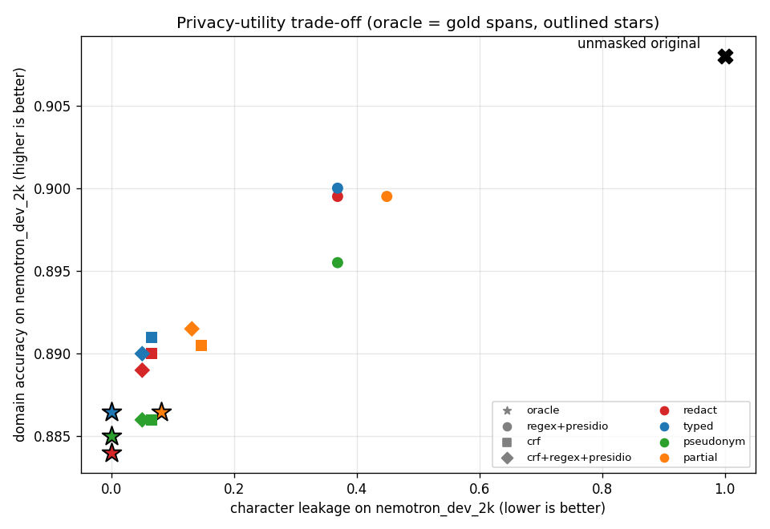

# Masking: privacy-utility trade-off (Milestone 5)

## Research questions

- **RQ7** For each detector x masking strategy: how much private information survives
  (privacy) and how much useful information is preserved (utility)?
- **RQ8** What do detector errors cost? Compare detector-based masking with ORACLE masking
  (gold spans) under each strategy.

Every number on this page is generated by `scripts/make_masking_tables.py` from the
committed `results/m5/masking.json` and `results/m5/domain_classifier.json`; the prose
contains no measured value. Theory: docs/theory/03-masking.md. Reproduce:

```
pip install -e ".[dev,data,detectors,ml,plots,masking]"
python scripts/run_masking.py classifier
python scripts/run_masking.py grid
python scripts/run_masking.py figure
python scripts/make_masking_tables.py
```

## Method

- **Detectors**: `oracle` (the gold spans: perfect detection), `regex+presidio` (best
  off-the-shelf detector, Milestone 3), `crf` and `crf+regex+presidio` (Milestone 4). Their
  stored predictions are reused; every run's evaluation-set SHA-256 is checked; nothing is
  retrained.
- **Strategies**: `redact`, `typed`, `pseudonym`, `partial` (privgate.masking), seed 0.
- **Privacy** (privgate.bench.privacy), on the masked text against the gold spans:
  `char_leakage` (gold characters still present at their mapped position; kept characters
  of partial masking count) and `verbatim_survival` (distinct gold values of at least 4
  characters still present anywhere in the masked text), with 95% document bootstrap CIs.
- **Utility** (privgate.bench.utility, privgate.bench.domain): `preserved_non_pii` (non-PII
  characters left unchanged), `length_ratio`, and a downstream proxy: classifying the
  Nemotron `domain` of a document. The classifier (TF-IDF word 1-2 grams, 200 000 features,
  logistic regression) is trained on the ORIGINAL text of a group-aware sample of Nemotron
  TRAIN documents (training-pool guard against every evaluation document); `C` is chosen by
  5-fold group-aware cross-validation on the training sample only. It is evaluated on
  `nemotron_dev_2k` only: the Nemotron test file shares almost no domain with the train file
  (docs/DATA.md) and Gretel has a single domain, so the task is undefined there. Utility drop
  = accuracy(unmasked) - accuracy(masked) on the same documents, with a paired bootstrap CI.
  A second classifier is trained on oracle-typed-masked training text ("the system always
  masks") and evaluated on typed-masked dev.

### Strategy fallbacks

<!-- m5_fallbacks:begin -->
- `pseudonym`: PERSON -> Faker `name()`, EMAIL -> Faker `email()`, PHONE -> Faker `phone_number()`, CREDIT_CARD -> Faker `credit_card_number()`, IBAN -> Faker `iban()`, IP_ADDRESS -> Faker `ipv4()`, URL -> Faker `url()`, DATE -> Faker `date()`, LOCATION -> Faker `city()`, ORGANIZATION -> Faker `company()`. **Fall back to typed**: ID_NUMBER, OTHER; also any value for which no fake could be found that is absent from the text and stays a whole token.
- `partial`: EMAIL keeps `@domain`; CREDIT_CARD, IBAN, PHONE keep their last 4 digits and separators when they have at least 8 digits. **Fall back to typed**: DATE, ID_NUMBER, IP_ADDRESS, LOCATION, ORGANIZATION, OTHER, PERSON, URL; EMAIL without `@`; CREDIT_CARD, IBAN, PHONE with fewer than 8 digits.
- `redact` and `typed` have no fallback.
<!-- m5_fallbacks:end -->

## Domain classifier

<!-- m5_classifier:begin -->
Training sample: 20,000 Nemotron train-split documents (10,000 persona groups, seed 0); training wall time 56.3 min.

| training text | C | mean CV accuracy | fold accuracies |  |
|---|---|---|---|---|
| original | 1.0 | 0.843 | 0.849, 0.843, 0.840, 0.839, 0.846 |  |
| original | 10.0 | 0.883 | 0.890, 0.885, 0.878, 0.878, 0.885 |  |
| original | 100.0 | 0.894 | 0.899, 0.894, 0.891, 0.891, 0.893 | **selected** |
| typed | 1.0 | 0.820 | 0.824, 0.822, 0.814, 0.822, 0.818 |  |
| typed | 10.0 | 0.865 | 0.872, 0.869, 0.863, 0.860, 0.861 |  |
| typed | 100.0 | 0.875 | 0.879, 0.881, 0.870, 0.871, 0.873 | **selected** |

Dev accuracy of the original-text classifier on unmasked dev: **0.908** (macro-F1 0.911); of the typed-text classifier on oracle-typed dev: 0.903 (macro-F1 0.904).
<!-- m5_classifier:end -->

## RQ7: privacy and utility of every detector x strategy



<!-- m5_rq7:begin -->
**`nemotron_dev_2k`** (unmasked dev: accuracy 0.908 [0.896, 0.921], macro-F1 0.911; utility drop = unmasked - masked)

| detector | strategy | char leakage | verbatim survival | preserved non-PII | length ratio | domain accuracy | macro-F1 | utility drop |
|---|---|---|---|---|---|---|---|---|
| `oracle` | redact | 0.000 [0.000, 0.000] | 0.001 [0.000, 0.001] | 1.000 | 0.952 | 0.884 [0.870, 0.899] | 0.886 | +0.024 [+0.015, +0.034] |
| `oracle` | typed | 0.000 [0.000, 0.000] | 0.001 [0.000, 0.001] | 1.000 | 0.957 | 0.886 [0.872, 0.900] | 0.887 | +0.022 [+0.013, +0.031] |
| `oracle` | pseudonym | 0.000 [0.000, 0.000] | 0.001 [0.001, 0.002] | 1.000 | 0.978 | 0.885 [0.870, 0.899] | 0.887 | +0.023 [+0.014, +0.033] |
| `oracle` | partial | 0.081 [0.077, 0.086] | 0.001 [0.000, 0.001] | 1.000 | 0.963 | 0.886 [0.872, 0.900] | 0.887 | +0.022 [+0.013, +0.031] |
| `regex+presidio` | redact | 0.369 [0.358, 0.379] | 0.322 [0.313, 0.330] | 0.988 | 0.969 | 0.899 [0.887, 0.912] | 0.903 | +0.009 [+0.002, +0.015] |
| `regex+presidio` | typed | 0.369 [0.358, 0.379] | 0.322 [0.313, 0.330] | 0.988 | 0.967 | 0.900 [0.887, 0.913] | 0.902 | +0.008 [+0.002, +0.015] |
| `regex+presidio` | pseudonym | 0.369 [0.358, 0.379] | 0.322 [0.313, 0.331] | 0.988 | 0.991 | 0.895 [0.882, 0.909] | 0.899 | +0.013 [+0.005, +0.020] |
| `regex+presidio` | partial | 0.449 [0.439, 0.459] | 0.322 [0.313, 0.330] | 0.988 | 0.973 | 0.899 [0.886, 0.913] | 0.902 | +0.009 [+0.002, +0.015] |
| `crf` | redact | 0.065 [0.059, 0.071] | 0.071 [0.066, 0.076] | 0.996 | 0.953 | 0.890 [0.876, 0.904] | 0.891 | +0.018 [+0.010, +0.027] |
| `crf` | typed | 0.065 [0.059, 0.071] | 0.071 [0.066, 0.076] | 0.996 | 0.958 | 0.891 [0.876, 0.905] | 0.891 | +0.017 [+0.009, +0.026] |
| `crf` | pseudonym | 0.065 [0.059, 0.071] | 0.071 [0.066, 0.076] | 0.996 | 0.978 | 0.886 [0.871, 0.901] | 0.888 | +0.022 [+0.013, +0.031] |
| `crf` | partial | 0.146 [0.139, 0.154] | 0.071 [0.066, 0.076] | 0.996 | 0.964 | 0.890 [0.876, 0.904] | 0.891 | +0.018 [+0.009, +0.026] |
| `crf+regex+presidio` | redact | 0.050 [0.045, 0.055] | 0.049 [0.044, 0.053] | 0.985 | 0.949 | 0.889 [0.875, 0.903] | 0.891 | +0.019 [+0.011, +0.029] |
| `crf+regex+presidio` | typed | 0.050 [0.045, 0.055] | 0.049 [0.044, 0.053] | 0.985 | 0.954 | 0.890 [0.876, 0.904] | 0.890 | +0.018 [+0.009, +0.027] |
| `crf+regex+presidio` | pseudonym | 0.050 [0.045, 0.055] | 0.049 [0.045, 0.054] | 0.985 | 0.976 | 0.886 [0.872, 0.901] | 0.887 | +0.022 [+0.013, +0.031] |
| `crf+regex+presidio` | partial | 0.131 [0.125, 0.138] | 0.049 [0.044, 0.053] | 0.985 | 0.960 | 0.891 [0.877, 0.906] | 0.892 | +0.017 [+0.007, +0.025] |

**`nemotron_test_5k`**

| detector | strategy | char leakage | verbatim survival | preserved non-PII | length ratio |
|---|---|---|---|---|---|
| `oracle` | redact | 0.000 [0.000, 0.000] | 0.001 [0.001, 0.001] | 1.000 | 0.956 |
| `oracle` | typed | 0.000 [0.000, 0.000] | 0.001 [0.001, 0.001] | 1.000 | 0.959 |
| `oracle` | pseudonym | 0.000 [0.000, 0.000] | 0.002 [0.001, 0.002] | 1.000 | 0.981 |
| `oracle` | partial | 0.093 [0.090, 0.096] | 0.001 [0.001, 0.001] | 1.000 | 0.967 |
| `regex+presidio` | redact | 0.351 [0.343, 0.357] | 0.310 [0.304, 0.315] | 0.986 | 0.970 |
| `regex+presidio` | typed | 0.351 [0.343, 0.357] | 0.310 [0.304, 0.315] | 0.986 | 0.967 |
| `regex+presidio` | pseudonym | 0.351 [0.343, 0.357] | 0.310 [0.304, 0.316] | 0.986 | 0.992 |
| `regex+presidio` | partial | 0.443 [0.436, 0.449] | 0.310 [0.304, 0.315] | 0.986 | 0.975 |
| `crf` | redact | 0.076 [0.072, 0.081] | 0.081 [0.077, 0.084] | 0.994 | 0.956 |
| `crf` | typed | 0.076 [0.072, 0.081] | 0.081 [0.077, 0.084] | 0.994 | 0.959 |
| `crf` | pseudonym | 0.076 [0.072, 0.081] | 0.081 [0.078, 0.085] | 0.994 | 0.980 |
| `crf` | partial | 0.170 [0.165, 0.175] | 0.081 [0.077, 0.084] | 0.994 | 0.966 |
| `crf+regex+presidio` | redact | 0.060 [0.056, 0.064] | 0.057 [0.054, 0.060] | 0.983 | 0.953 |
| `crf+regex+presidio` | typed | 0.060 [0.056, 0.064] | 0.057 [0.054, 0.060] | 0.983 | 0.955 |
| `crf+regex+presidio` | pseudonym | 0.060 [0.056, 0.064] | 0.058 [0.055, 0.061] | 0.983 | 0.978 |
| `crf+regex+presidio` | partial | 0.153 [0.148, 0.157] | 0.057 [0.054, 0.060] | 0.983 | 0.962 |

**`gretel_en_test`**

| detector | strategy | char leakage | verbatim survival | preserved non-PII | length ratio |
|---|---|---|---|---|---|
| `oracle` | redact | 0.000 [0.000, 0.000] | 0.000 [0.000, 0.000] | 1.000 | 0.974 |
| `oracle` | typed | 0.000 [0.000, 0.000] | 0.000 [0.000, 0.000] | 1.000 | 0.980 |
| `oracle` | pseudonym | 0.000 [0.000, 0.000] | 0.001 [0.000, 0.003] | 1.000 | 0.985 |
| `oracle` | partial | 0.036 [0.033, 0.040] | 0.000 [0.000, 0.000] | 1.000 | 0.982 |
| `regex+presidio` | redact | 0.509 [0.498, 0.521] | 0.356 [0.345, 0.368] | 0.944 | 0.982 |
| `regex+presidio` | typed | 0.509 [0.498, 0.521] | 0.356 [0.345, 0.368] | 0.944 | 0.983 |
| `regex+presidio` | pseudonym | 0.509 [0.498, 0.521] | 0.356 [0.345, 0.368] | 0.944 | 1.000 |
| `regex+presidio` | partial | 0.544 [0.532, 0.554] | 0.356 [0.345, 0.368] | 0.947 | 0.985 |
| `crf` | redact | 0.412 [0.400, 0.423] | 0.290 [0.281, 0.301] | 0.943 | 0.969 |
| `crf` | typed | 0.412 [0.400, 0.423] | 0.290 [0.281, 0.301] | 0.943 | 0.971 |
| `crf` | pseudonym | 0.412 [0.400, 0.423] | 0.292 [0.282, 0.302] | 0.943 | 0.982 |
| `crf` | partial | 0.442 [0.430, 0.453] | 0.290 [0.281, 0.301] | 0.945 | 0.973 |
| `crf+regex+presidio` | redact | 0.318 [0.306, 0.331] | 0.211 [0.202, 0.220] | 0.921 | 0.963 |
| `crf+regex+presidio` | typed | 0.318 [0.306, 0.331] | 0.211 [0.202, 0.220] | 0.921 | 0.965 |
| `crf+regex+presidio` | pseudonym | 0.318 [0.306, 0.331] | 0.212 [0.203, 0.222] | 0.921 | 0.981 |
| `crf+regex+presidio` | partial | 0.353 [0.341, 0.365] | 0.211 [0.202, 0.220] | 0.923 | 0.968 |
<!-- m5_rq7:end -->

Second setting: classifier trained on oracle-typed-masked training text, evaluated on
typed-masked dev.

<!-- m5_setting_b:begin -->
| detector (typed masking) | original-text classifier | typed-text classifier | typed-text macro-F1 | drop vs unmasked original classifier |
|---|---|---|---|---|
| `oracle` | 0.886 [0.872, 0.900] | 0.903 [0.889, 0.916] | 0.904 | +0.005 [-0.004, +0.014] |
| `regex+presidio` | 0.900 [0.887, 0.913] | 0.905 [0.892, 0.918] | 0.908 | +0.003 [-0.005, +0.011] |
| `crf` | 0.891 [0.876, 0.905] | 0.902 [0.889, 0.914] | 0.903 | +0.006 [-0.003, +0.015] |
| `crf+regex+presidio` | 0.890 [0.876, 0.904] | 0.900 [0.887, 0.914] | 0.902 | +0.008 [-0.002, +0.017] |
<!-- m5_setting_b:end -->

Per gold label on `nemotron_dev_2k`, typed masking:

<!-- m5_perlabel:begin -->
char leakage / verbatim survival:

| gold label | `oracle` | `regex+presidio` | `crf+regex+presidio` |
|---|---|---|---|
| CREDIT_CARD | 0.000 / 0.000 | 0.519 / 0.359 | 0.000 / 0.000 |
| DATE | 0.000 / 0.000 | 0.057 / 0.023 | 0.027 / 0.014 |
| EMAIL | 0.000 / 0.000 | 0.002 / 0.004 | 0.002 / 0.004 |
| ID_NUMBER | 0.000 / 0.000 | 0.456 / 0.343 | 0.016 / 0.008 |
| IP_ADDRESS | 0.000 / 0.000 | 0.106 / 0.060 | 0.005 / 0.004 |
| LOCATION | 0.000 / 0.001 | 0.400 / 0.310 | 0.035 / 0.032 |
| ORGANIZATION | 0.000 / 0.004 | 0.928 / 0.932 | 0.074 / 0.072 |
| OTHER | 0.000 / 0.001 | 0.774 / 0.631 | 0.151 / 0.139 |
| PERSON | 0.000 / 0.000 | 0.113 / 0.175 | 0.035 / 0.060 |
| PHONE | 0.000 / 0.000 | 0.038 / 0.036 | 0.000 / 0.000 |
| URL | 0.000 / 0.000 | 0.008 / 0.000 | 0.003 / 0.000 |
<!-- m5_perlabel:end -->

## RQ8: the cost of detector errors (gap to the oracle)

<!-- m5_rq8:begin -->
Detector minus oracle under the same strategy (positive leakage gap = the detector leaks more; negative accuracy gap = the detector costs accuracy).

**`nemotron_dev_2k`**

| detector | strategy | char leakage gap | verbatim survival gap | preserved non-PII gap | accuracy gap [CI] |
|---|---|---|---|---|---|
| `regex+presidio` | redact | +0.369 | +0.321 | -0.012 | +0.015 [+0.009, +0.023] |
| `regex+presidio` | typed | +0.369 | +0.321 | -0.012 | +0.014 [+0.006, +0.021] |
| `regex+presidio` | pseudonym | +0.369 | +0.321 | -0.012 | +0.010 [+0.002, +0.019] |
| `regex+presidio` | partial | +0.367 | +0.321 | -0.012 | +0.013 [+0.006, +0.021] |
| `crf` | redact | +0.065 | +0.070 | -0.004 | +0.006 [+0.002, +0.011] |
| `crf` | typed | +0.065 | +0.070 | -0.004 | +0.005 [+0.000, +0.009] |
| `crf` | pseudonym | +0.065 | +0.070 | -0.004 | +0.001 [-0.004, +0.005] |
| `crf` | partial | +0.065 | +0.070 | -0.004 | +0.004 [-0.001, +0.009] |
| `crf+regex+presidio` | redact | +0.050 | +0.048 | -0.015 | +0.005 [-0.001, +0.011] |
| `crf+regex+presidio` | typed | +0.050 | +0.048 | -0.015 | +0.004 [-0.002, +0.009] |
| `crf+regex+presidio` | pseudonym | +0.050 | +0.048 | -0.015 | +0.001 [-0.005, +0.007] |
| `crf+regex+presidio` | partial | +0.050 | +0.048 | -0.015 | +0.005 [+0.000, +0.010] |

**`nemotron_test_5k`**

| detector | strategy | char leakage gap | verbatim survival gap | preserved non-PII gap |
|---|---|---|---|---|
| `regex+presidio` | redact | +0.351 | +0.309 | -0.014 |
| `regex+presidio` | typed | +0.351 | +0.309 | -0.014 |
| `regex+presidio` | pseudonym | +0.351 | +0.309 | -0.014 |
| `regex+presidio` | partial | +0.350 | +0.309 | -0.014 |
| `crf` | redact | +0.076 | +0.080 | -0.006 |
| `crf` | typed | +0.076 | +0.080 | -0.006 |
| `crf` | pseudonym | +0.076 | +0.079 | -0.006 |
| `crf` | partial | +0.077 | +0.080 | -0.006 |
| `crf+regex+presidio` | redact | +0.060 | +0.056 | -0.017 |
| `crf+regex+presidio` | typed | +0.060 | +0.056 | -0.017 |
| `crf+regex+presidio` | pseudonym | +0.060 | +0.056 | -0.017 |
| `crf+regex+presidio` | partial | +0.059 | +0.056 | -0.017 |

**`gretel_en_test`**

| detector | strategy | char leakage gap | verbatim survival gap | preserved non-PII gap |
|---|---|---|---|---|
| `regex+presidio` | redact | +0.509 | +0.356 | -0.056 |
| `regex+presidio` | typed | +0.509 | +0.356 | -0.056 |
| `regex+presidio` | pseudonym | +0.509 | +0.355 | -0.056 |
| `regex+presidio` | partial | +0.507 | +0.356 | -0.053 |
| `crf` | redact | +0.412 | +0.290 | -0.057 |
| `crf` | typed | +0.412 | +0.290 | -0.057 |
| `crf` | pseudonym | +0.412 | +0.291 | -0.057 |
| `crf` | partial | +0.406 | +0.290 | -0.055 |
| `crf+regex+presidio` | redact | +0.318 | +0.211 | -0.079 |
| `crf+regex+presidio` | typed | +0.318 | +0.211 | -0.079 |
| `crf+regex+presidio` | pseudonym | +0.318 | +0.211 | -0.079 |
| `crf+regex+presidio` | partial | +0.317 | +0.211 | -0.077 |
<!-- m5_rq8:end -->

## Observations

Generated from the tables above.

<!-- m5_observations:begin -->
- `redact`, oracle on dev: char leakage 0.000, verbatim survival 0.001, accuracy 0.884.
- `typed`, oracle on dev: char leakage 0.000, verbatim survival 0.001, accuracy 0.886.
- `pseudonym`, oracle on dev: char leakage 0.000, verbatim survival 0.001, accuracy 0.885.
- `partial`, oracle on dev: char leakage 0.081, verbatim survival 0.001, accuracy 0.886.
- Lowest non-oracle char leakage on dev: `crf+regex+presidio` pseudonym 0.050.
- Largest utility drop on dev: `oracle` redact +0.024 [+0.015, +0.034].
- `nemotron_dev_2k`, typed: `crf+regex+presidio` char leakage 0.050 (oracle 0.000), verbatim survival 0.049 (oracle 0.001).
- `nemotron_test_5k`, typed: `crf+regex+presidio` char leakage 0.060 (oracle 0.000), verbatim survival 0.057 (oracle 0.001).
- `gretel_en_test`, typed: `crf+regex+presidio` char leakage 0.318 (oracle 0.000), verbatim survival 0.211 (oracle 0.000).
- Selected classifier C: original text 100.0, typed text 100.0.
<!-- m5_observations:end -->

Reading notes (no numbers; see the tables):

- **Privacy is set by the detector, not by the strategy.** For redact, typed and pseudonym
  the character leakage equals the detector's leakage of Milestones 3-4; the strategy only
  changes what the model sees in place of the detected spans. Partial masking adds exactly
  the kept characters on top.
- **Verbatim survival exposes missed repeats.** A detector that misses one of two mentions
  of a name leaves the value readable even though the other mention is masked; the oracle's
  small non-zero survival comes from values that also occur in unlabelled places. It is a
  substring test, so a pseudonym that happens to contain a gold value (a fake company name
  containing a surname) counts as survival too.
- **Masking more costs more utility.** The oracle masks the most and costs the original-text
  classifier the most accuracy; detectors that miss PII lose less accuracy because they
  leave more text. A classifier trained on typed-masked text recovers most of the loss: its
  drop against the unmasked original classifier has intervals that include zero.
- **The cost of detector errors is mostly privacy.** The gap to the oracle is large in
  leakage and verbatim survival, and small in accuracy and preserved non-PII text.

## Threats to validity

- **Domain classification is one proxy of utility**, chosen because it can be measured
  without an external model. It says whether the topic of a document survives masking, not
  whether a language model would still answer questions about it correctly: LLM answer
  quality is NOT MEASURED here.
- **Synthetic data.** Texts, values and labels are generated; real documents mention people
  in more varied ways (nicknames, initials, misspellings), which makes consistency and
  verbatim survival harder.
- **Exact-string consistency.** Two spellings of one person get two placeholders; a model
  then treats them as two people. Not measured.
- **Oracle = gold spans**, which inherit the annotation noise of Milestone 2; an unlabelled
  mention of a value counts against every detector, the oracle included (so the oracle's
  verbatim survival can be non-zero).
- **Classifier grid edge.** Cross-validation selected the largest `C` of the grid for both
  training texts, so a larger `C` might classify better; the grid was fixed in advance and
  not extended. All masked versions are scored with the same classifier, so the comparisons
  between them are unaffected; absolute accuracies may be slightly underestimated.
- **Single seed, single laptop.** Masking is deterministic; pseudonyms depend on the pinned
  Faker version (40.43.0).
