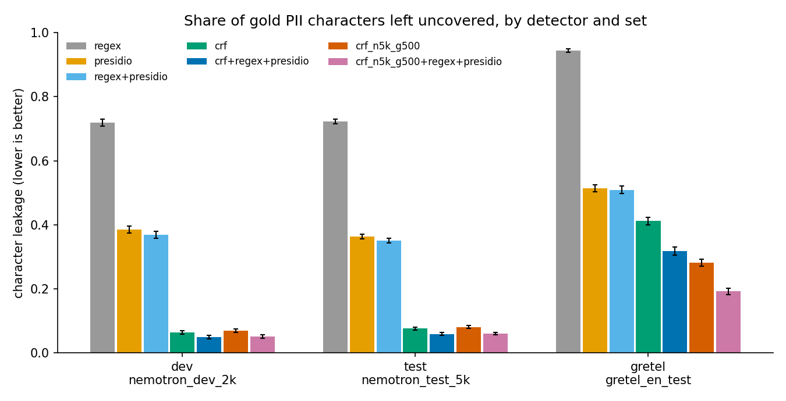

# Results (consolidated)

Generated by `scripts/make_results.py` from the committed JSON under `results/`. Detailed
files: [results-detection.md](results-detection.md) (RQ1-RQ6),
[results-masking.md](results-masking.md) (RQ7-RQ8), [results-gateway.md](results-gateway.md)
(RQ9-RQ10), [results-adaptation.md](results-adaptation.md) (RQ11),
[error-analysis.md](error-analysis.md) and [error-examples.md](error-examples.md); the
gateway is described in [GATEWAY.md](GATEWAY.md), the data in [DATA.md](DATA.md).

## Summary

On three synthetic evaluation sets (dev, Nemotron test, Gretel), the best off-the-shelf configuration (`regex+presidio`) leaves 0.369, 0.351, 0.509 of the gold PII characters uncovered. A CRF trained on 5,000 Nemotron documents gives 0.065, 0.076, 0.412, and the union `crf+regex+presidio` 0.050, 0.060, 0.318: the gain is large in-domain and smaller out of distribution. Adding Gretel training documents moves the Gretel leakage of the CRF from 0.412 to 0.282 (`crf_n5k_g500`); on Gretel, `crf_n5k_g500` leaks less than `crf+regex+presidio` (0.282 vs 0.318). Under every masking strategy the privacy of the output is set by the detector, not by the strategy (RQ7). Fail-closed: 0 unscreened requests forwarded and 0 fault-induced leaks over 1783 injected faults. Fail-open: the worst condition (exception, q = 0.2) leaked 207 of 1000 requests. Fail-closed availability at q = 0.2 with a detector fault was at least 0.792.

## Headline: leakage by detector and set

Character leakage = share of gold PII characters left uncovered by the detected spans (lower is better), with 95 % document-bootstrap intervals. The rows after `crf+regex+presidio` are adapted models (RQ11): `crf_n5k_g500` is the single RQ11 model with the lowest Gretel leakage, a choice made on the Gretel test set itself; `crf_n5k_g500+regex+presidio` was pre-declared as a descriptive addition. Rows marked (b) or (c) are adapted models, evaluated on sets that include the Gretel test set that was also used to pick the best of them; their Gretel numbers are descriptive, not a validated selection.

| detector | dev (`nemotron_dev_2k`) | test (`nemotron_test_5k`) | gretel (`gretel_en_test`) |
|---|---|---|---|
| `regex` | 0.718 [0.708, 0.730] | 0.723 [0.715, 0.729] | 0.944 [0.939, 0.950] |
| `presidio` | 0.385 [0.374, 0.396] | 0.364 [0.356, 0.371] | 0.514 [0.503, 0.526] |
| `regex+presidio` | 0.369 [0.358, 0.379] | 0.351 [0.343, 0.357] | 0.509 [0.498, 0.521] |
| `crf` | 0.065 [0.059, 0.071] | 0.076 [0.072, 0.081] | 0.412 [0.400, 0.423] |
| `crf+regex+presidio` | 0.050 [0.045, 0.055] | 0.060 [0.056, 0.064] | 0.318 [0.306, 0.331] |
| `crf_n5k_g500` — (b) Nemotron 5000 + Gretel 500 | 0.070 [0.064, 0.076] | 0.081 [0.077, 0.085] | 0.282 [0.270, 0.294] |
| `crf_n5k_g500+regex+presidio` — (b) adapted CRF + regex + Presidio | 0.052 [0.047, 0.057] | 0.061 [0.057, 0.065] | 0.192 [0.181, 0.203] |

## Research questions

### RQ1-RQ3: off-the-shelf detection
How well do a rule-based baseline and off-the-shelf NER/PII tools detect PII; how does this
change across dev, Nemotron test and Gretel; which types leak? Details:
[results-detection.md](results-detection.md).

| detector (dev) | type-agnostic F1 | leakage |
|---|---|---|
| `regex` | 0.240 [0.231, 0.248] | 0.718 [0.708, 0.730] |
| `presidio` | 0.743 [0.735, 0.751] | 0.385 [0.374, 0.396] |
| `regex+presidio` | 0.744 [0.736, 0.752] | 0.369 [0.358, 0.379] |
| `spacy` | 0.551 [0.540, 0.562] | 0.654 [0.643, 0.666] |
| `regex+spacy` | 0.652 [0.643, 0.662] | 0.398 [0.386, 0.409] |

Largest contributors to the leaked characters of `regex+presidio` on dev (RQ3): OTHER 44.4% of leaked characters (type leakage 0.774); ORGANIZATION 28.5% of leaked characters (type leakage 0.928); ID_NUMBER 11.8% of leaked characters (type leakage 0.456); LOCATION 8.4% of leaked characters (type leakage 0.400).

### RQ4-RQ6: a trained sequence model
Does a CRF trained on Nemotron reduce leakage (RQ4), how does it scale with data (RQ5, dev:
n = 1000: F1 0.912, leakage 0.097; n = 5000: F1 0.940, leakage 0.065), and what do transitions add (RQ6)? Paired differences:

| paired leakage difference | dev | test | gretel |
|---|---|---|---|
| `crf` − `regex+presidio` (RQ4) | -0.304 [-0.316, -0.293] | -0.274 [-0.281, -0.267] | -0.097 [-0.108, -0.086] |
| `crf+regex+presidio` − `regex+presidio` (RQ4) | -0.319 [-0.330, -0.308] | -0.291 [-0.297, -0.284] | -0.191 [-0.199, -0.183] |
| `crf` − `logreg` (RQ6) | -0.009 [-0.013, -0.006] | -0.010 [-0.013, -0.008] | -0.011 [-0.017, -0.004] |

### RQ7-RQ8: masking strategies and the cost of detector errors
Privacy and utility of every detector x strategy, and the gap to oracle masking. Details:
[results-masking.md](results-masking.md).

| strategy (`crf+regex+presidio`, dev) | char leakage | preserved non-PII | domain-accuracy drop |
|---|---|---|---|
| redact | 0.050 [0.045, 0.055] | 0.985 | +0.019 [+0.011, +0.029] |
| typed | 0.050 [0.045, 0.055] | 0.985 | +0.018 [+0.009, +0.027] |
| pseudonym | 0.050 [0.045, 0.055] | 0.985 | +0.022 [+0.013, +0.031] |
| partial | 0.131 [0.125, 0.138] | 0.985 | +0.017 [+0.007, +0.025] |

### RQ9: fail-closed under injected faults
Fail-closed: 0 unscreened requests forwarded and 0 fault-induced leaks over 1783 injected faults. Fail-open: the worst condition (exception, q = 0.2) leaked 207 of 1000 requests. Fail-closed availability at q = 0.2 with a detector fault was at least 0.792.

### RQ10: gateway latency
*measured under recorded background load (not an idle machine); median of 3 runs.*

| harness (c = 1) | config | p50 ms | p95 ms | req/s |
|---|---|---|---|---|
| asgi | `none` | 2.08 | 3.52 | 181.7 |
| asgi | `regex` | 2.61 | 4.46 | 165.1 |
| asgi | `crf` | 9.92 | 216.27 | 35.0 |
| asgi | `crf+regex` | 10.42 | 217.07 | 35.4 |
| asgi | `crf+regex+presidio` | 105.50 | 1933.16 | 2.9 |
| server | `none` | 5.98 | 8.96 | 60.1 |
| server | `regex` | 6.52 | 11.02 | 58.3 |
| server | `crf` | 14.97 | 202.14 | 23.0 |
| server | `crf+regex` | 15.16 | 260.23 | 22.9 |
| server | `crf+regex+presidio` | 137.16 | 744.35 | 3.8 |

Protocol and load records: [results-gateway.md](results-gateway.md).

### RQ11: domain adaptation
Does a small amount of target-domain data fix the Gretel leakage? Full tables:
[results-adaptation.md](results-adaptation.md).

- `crf_g500` on `nemotron_dev_2k`: leakage 0.065 → 0.774 (relative change +1096.6%; the paired CI says higher); type-agnostic F1 -0.582.
- `crf_g500` on `nemotron_test_5k`: leakage 0.076 → 0.770 (relative change +909.6%; the paired CI says higher); type-agnostic F1 -0.583.
- `crf_g500` on `gretel_en_test`: leakage 0.412 → 0.334 (relative change -18.8%; the paired CI says lower); type-agnostic F1 +0.263.
- `crf_n5k_g100` on `nemotron_dev_2k`: leakage 0.065 → 0.068 (relative change +4.7%; the paired CI says higher); type-agnostic F1 -0.001.
- `crf_n5k_g100` on `nemotron_test_5k`: leakage 0.076 → 0.080 (relative change +4.9%; the paired CI says higher); type-agnostic F1 -0.002.
- `crf_n5k_g100` on `gretel_en_test`: leakage 0.412 → 0.338 (relative change -18.0%; the paired CI says lower); type-agnostic F1 +0.138.
- `crf_n5k_g500` on `nemotron_dev_2k`: leakage 0.065 → 0.070 (relative change +8.0%; the paired CI says higher); type-agnostic F1 -0.005.
- `crf_n5k_g500` on `nemotron_test_5k`: leakage 0.076 → 0.081 (relative change +6.6%; the paired CI says higher); type-agnostic F1 -0.004.
- `crf_n5k_g500` on `gretel_en_test`: leakage 0.412 → 0.282 (relative change -31.5%; the paired CI says lower); type-agnostic F1 +0.229.
- `crf_n5k_g500+regex+presidio` on `nemotron_dev_2k`: leakage 0.065 → 0.052 (relative change -20.1%; the paired CI says lower); type-agnostic F1 -0.026.
- `crf_n5k_g500+regex+presidio` on `nemotron_test_5k`: leakage 0.076 → 0.061 (relative change -20.1%; the paired CI says lower); type-agnostic F1 -0.026.
- `crf_n5k_g500+regex+presidio` on `gretel_en_test`: leakage 0.412 → 0.192 (relative change -53.3%; the paired CI says lower); type-agnostic F1 +0.036.
- On `nemotron_dev_2k`: `crf_n5k_g500` leaks more than `crf+regex+presidio` (0.070 vs 0.050).
- On `nemotron_dev_2k`: `crf_n5k_g500+regex+presidio` leaks more than `crf+regex+presidio` (0.052 vs 0.050).
- On `nemotron_test_5k`: `crf_n5k_g500` leaks more than `crf+regex+presidio` (0.081 vs 0.060).
- On `nemotron_test_5k`: `crf_n5k_g500+regex+presidio` leaks more than `crf+regex+presidio` (0.061 vs 0.060).
- On `gretel_en_test`: `crf_n5k_g500` leaks less than `crf+regex+presidio` (0.282 vs 0.318).
- On `gretel_en_test`: `crf_n5k_g500+regex+presidio` leaks less than `crf+regex+presidio` (0.192 vs 0.318).

### Final error analysis
- `nemotron_dev_2k`: 955 of 15567 gold spans leak (0.061); largest mapped label OTHER (63.2%), largest raw label `occupation` (37.0%), largest position prose (86.5%).
- `nemotron_test_5k`: 2684 of 40000 gold spans leak (0.067); largest mapped label OTHER (58.3%), largest raw label `occupation` (32.0%), largest position prose (81.5%).
- `gretel_en_test`: 3418 of 12719 gold spans leak (0.269); largest mapped label ORGANIZATION (73.1%), largest raw label `company` (73.1%), largest position prose (81.6%).

Tables: [error-analysis.md](error-analysis.md); examples: [error-examples.md](error-examples.md).

## Threats to validity

- **Synthetic data only.** Nemotron-PII and the Gretel finance set are generated. Their text is
  more regular than real documents, and their labels come from the generator or an NER+LLM
  pass; a detector's "false positive" can be real, unlabelled PII.
- **One generator for train and two of three evaluation sets.** Nemotron train, dev and test
  share templates and label set; in-domain gains partly measure how well a model learned that
  generator. Gretel is the only independent set, and it is itself a single generator.
- **Label mapping and heterogeneous OTHER.** Raw labels are mapped onto 12 types by hand.
  Strict and partial scores depend on the mapping; character leakage and type-agnostic scores
  do not. OTHER mixes very different attributes.
- **Detectors.** Presidio and spaCy ran with library defaults (one Presidio threshold chosen on
  dev); the CRF and logistic regression were trained on at most 5,000 documents with
  hyper-parameters chosen on n = 1,000; the union ensembles maximise coverage, not precision.
- **Masking and utility.** Utility is the accuracy of one bag-of-words domain classifier on one
  dataset; it says nothing about the quality of an LLM's answer to a masked prompt.
- **Gateway experiments.** MockUpstream, a replayed detector (checked on 25 documents), four
  injected fault types applied independently one request at a time, and single-message
  synthetic requests. The leak metric is verbatim presence of gold values of at least four
  characters.
- **Latency.** One Windows laptop, one process, one detector worker, a mock upstream with 0 ms
  latency, configurations run in a fixed order. The idle criterion was never met, so the
  numbers are medians of three runs measured under recorded background load
  (results-gateway.md).
- **Domain adaptation (RQ11).** One seed, two sample sizes, one set of hyper-parameters; the
  Gretel train and test files come from the same generator and may share templates even when no
  text is identical.
- **Error taxonomy.** Categories are computed by simple rules (format, line position); they
  describe leaked spans, they do not explain why the model missed them.
- **Selection on evaluation data.** The "best RQ11 model" in the headline table is the lowest
  Gretel leakage among three models, chosen on the Gretel test set; it is a description, not a
  validated choice.

## What this project does NOT show

- Performance on **real-world data**: every document is synthetic.
- Detection of PII in **languages other than English**, in **images, audio or files**, or in
  code and structured logs beyond what the synthetic documents contain.
- That any configuration is **safe to use with real personal data**: a substantial share of gold
  PII characters still leaks on every set, and the gateway cannot do better than its detector.
- The effect of masking on the **quality of an LLM's answer**: no model was queried; utility is
  measured by a bag-of-words domain classifier and by text preservation.
- **Re-identification risk** from quasi-identifiers or context that is not labelled as PII.
- **End-to-end latency** with a real model, or latency on other hardware; the numbers are a
  mock-upstream, single-laptop measurement under background load.
- Robustness of the gateway to a **detector that hangs forever**, to load beyond concurrency 4,
  to malicious clients (no authentication, TLS or rate limiting), or to natural (not injected)
  faults.
- That a **small amount of target-domain data** generalises beyond the one synthetic target
  domain, one seed and two sample sizes tested.
